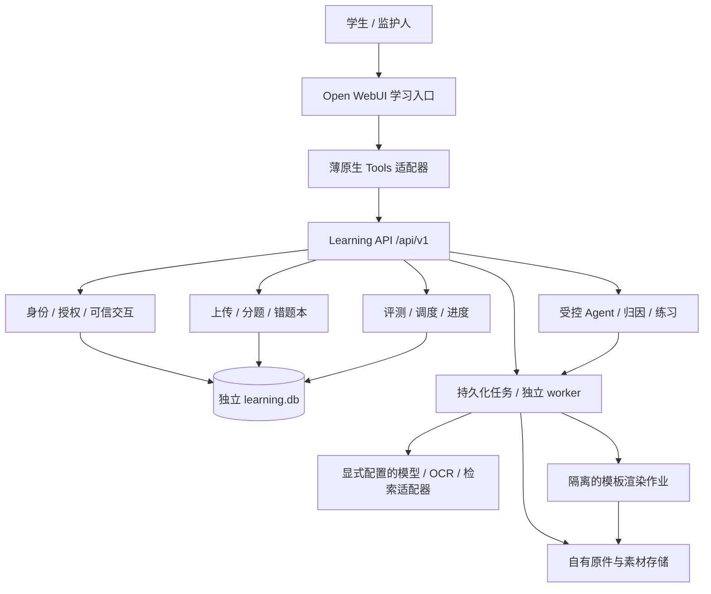

# 智能学习系统设计开发文档

文档版本：DD-1.0  
编制日期：2026-11-02（Asia/Shanghai）  
项目位置：本仓库根目录
用途：需求确认、技术实现、开发交接与验收依据。  
状态：**设计基线已落实为独立学习服务的本地 V1 实现；自动化验收与隔离 Open WebUI 0.12.5 Tool 注册/原生 loader 探针已完成，真实浏览器最终可信回调、提供商和学习者验收仍未完成。** 当前实现与证据见 `docs/goal/STATUS.md`、`docs/verification/`；正式切换和 T23 真实试用仍需授权与真实条件。

## 0. 阅读说明与依据

本文件将基础闭环 R2、试卷作业导入 U1、多模态与 Agent 方案合并为统一开发规格。接口路径、实体和目录均为拟实施契约，不表示运行实例已经具备。代码启动前应将本规格落实为版本化 OpenAPI、数据库迁移与自动化验收。

| 文档 | 用途 |
| --- | --- |
| [开发任务与验收清单](IMPLEMENTATION_BACKLOG.md) | 工作包、依赖、交付证据和发布门槛 |
| [主规划与本机核验](LEARNING_SYSTEM_REVIEW_AND_PLAN_2026-11-02.md) | 运行基线、R2 决策与 U1 范围增补 |
| [试卷与作业导入](PAPER_HOMEWORK_IMPORT_DESIGN.md) | 分题、批改识别、复核、入库与去重细则 |
| [多模态与 Agent 设计](MULTIMODAL_AGENT_LEARNING_DESIGN.md) | 模型、绘图、交互动画、视频与动图的教学用途 |
| [升级兼容与恢复](UPGRADE_COMPATIBILITY_AND_RECOVERY.md) | 版本固定、备份集、隔离演练与回退操作约束 |
| [二次审查记录](SECOND_REVIEW_2026-11-02.md) | 历史问题及修订理由；不作为当前新增范围清单 |
| [数轴原型说明](prototypes/README.md) | 已完成的离线演示及验证边界 |

规范关系：本文件负责统一开发命名、接口和验收映射；专题文档保留对应细则。调度遵循 R2 `interval-v1`；本文件未更改原间隔与维护门槛。若实现发现冲突，应先记录并同步修改相关文档，不能自行弱化确认、授权、数据恢复或教学/测验隔离要求。

本地事实引用 2026-11-02 的既有核验：Open WebUI 0.12.5、Compose 使用可变 `:main`、已有教材与绘图工具；其中“尚无学习业务服务”是该日期的历史快照。具体宿主机端口、镜像 digest 和本地运行清点已从公开快照中省略。2026-11-03 已有独立学习服务、schema revision 6、页面修订/复核申请、隔离 Compose 和 Open WebUI Tool 注册探针，具体以 `docs/verification/` 为准。本文件不把历史快照或隔离证据等同于正式 Open WebUI 接入；实施正式切换前应重新确认目标环境。

## 1. 产品目标与交付范围

### 1.1 目标

形成“新学记录／试卷作业 → 练习 → 错题收集 → 证据归因 → 针对性教学 → 独立变式复测 → 复习调度”的闭环。系统应减少抄题与整理负担，帮助学生解释错误并通过新题验证，而非仅积累图片或播放动画。

### 1.2 V1 必需范围

1. 学习者档案、账号授权、明确的当前学习者。
2. 新学知识点、文字和单题输入，以及整份试卷/作业的多图/PDF 上传。
3. 自动分题、提取学生作答与批改、筛选疑似错题；批量确认正式入库。
4. 可追溯错题本：原图定位、原始作答、部分错误小问、诊断版本和撤回。
5. 受约束的归因与变式题，支持题型的可靠校验及争议复核。
6. 分阶段间隔复习、今日任务、可信作答、服务端判分与调度。
7. 受控 Agent：选择任务、追问、工具调用与学习反馈，不拥有审批或改分权限。
8. 一个参数化数轴教学模板正式接入；复用已有绘图能力时经过兼容验证，失败可回退文字/静态图。
9. 独立数据存储、升级隔离、备份恢复、运行观察与数据导出/删除入口。

### 1.3 后续范围

- 等式与十进制分组模板、视频/GIF 导出、更多学科与教学短片。
- 已验收题型的策略化自动入库；复杂手写推导、几何与开放题扩大判分覆盖。
- 站外提醒、完整家长门户、FSRS 影子评估与个人化算法。

后续范围在本文件中给出扩展边界，不混入 V1 已承诺验收。首期七年级数学选定章节试点，数据结构支持多个学习者；不承诺全学科无人复核或模型准确率。

### 1.4 术语

| 术语 | 定义 |
| --- | --- |
| 资料 | 一次试卷/作业来源及其原文件、页序与可选参考答案 |
| 候选题 | 识别结果，可能需要修改分题、转写或判定，不等于正式错题 |
| 错题条目 | 学习者关于某道题的正式记录，可关联多次真实错误来源 |
| 复习目标 | 稳定知识点下可独立考核的能力，如“理解减去负数的运算方向” |
| 复习卡 | 学习者与一个复习目标的调度状态，不是每张图片一张卡 |
| 独立作答 | 可信输入且系统内未发现提示/答案暴露；不是监考证明 |
| 暴露事件 | 服务发放或展示过目标相关教学、练习、提示/答案的事件；区分内容发放与可观测观看 |

## 2. 需求编号与角色

### 2.1 需求追踪

| ID | 需求 | 优先级 | 验收编号 |
| --- | --- | --- | --- |
| R01 | 学习者与账号分离，跨学习者数据隔离 | 必需 | QA01 |
| R02 | 多图/PDF 整卷上传、排序、原件与任务进度 | 必需 | QA02 |
| R03 | 分题、跨页/小问关联、转写与批改分离 | 必需 | QA03 |
| R04 | 五类判定、答案映射、批量确认与幂等入库 | 必需 | QA04、QA05 |
| R05 | 错题本、来源追溯、修订、导出与撤回 | 必需 | QA05、QA13 |
| R06 | 有证据的错因假设与分级补救 | 必需 | QA06 |
| R07 | 审核母题、受约束变式、发布前校验 | 必需 | QA07 |
| R08 | 可信独立作答、判分、争议复核与防答案泄露 | 必需 | QA08 |
| R09 | 确定性间隔调度、预算与掌握证据 | 必需 | QA09 |
| R10 | 新学记录及无错题的正常练习 | 必需 | QA10 |
| R11 | 有界 Agent 编排、工具权限与预算 | 必需 | QA11 |
| R12 | 图示/数轴交互、静态回退与辅助记录 | V1 单模板 | QA12 |
| R13 | 后台恢复、审计、资料生命周期 | 必需 | QA13、QA14 |
| R14 | Open WebUI 升级兼容与一致性恢复 | 必需 | QA15 |
| R15 | 更多模板、隔离渲染视频与 GIF | 后续 | QA16 |
| R16 | 经过批准的规则化自动入库 | 后续 | QA17 |

### 2.2 角色与权限

| 角色 | 权限 | 不允许 |
| --- | --- | --- |
| 学生 | 自己的资料上传、转写确认、学习、作答、复核请求 | 访问其他学习者、批准争议判分、修改标准答案 |
| 监护人 | 已获授权的学习者管理、资料整理、查看进度、导出/删除申请 | 按姓名认领未授权学习者；绕过内容审核直接改成绩 |
| 内容审核者 | 授权范围内的题目/答案审核、争议裁决 | 自动拥有所有学生资料；无范围授权的数据读取 |
| 管理员 | 身份绑定、角色配置、策略与运行维护 | 通过模型对话绕过管理入口操作 |
| Agent/模型 | 允许清单内的查询、候选生成与交互发起 | 自报身份、伪造确认、提交学生最终答案、写成绩、修改调度 |

一个人可以拥有多种角色，但需显式授权。平台管理员身份不自动等于学习业务库中任意资料的内容访问授权。

## 3. 系统架构与边界



### 3.1 组件职责

| 组件 | 职责与实现选择 |
| --- | --- |
| Open WebUI | 继续承担聊天、现有模型与教材使用；官方镜像不做源码二开 |
| 原生 Tools 适配器 | 获取可信账号上下文、处理附件权限和交互回调，调用允许的业务接口 |
| Learning Service | FastAPI 单独服务；授权、业务状态、调度和数据访问为权威实现 |
| 学习数据库 | 首期独立 SQLite；版本化迁移与短事务；高并发/多副本作为未来迁移条件 |
| 任务 worker | 从持久化 jobs 领取 OCR、归因、生成等作业；租约、防重复、有限重试 |
| 渲染作业 | 参数化已审核模板生成素材；与业务 API 隔离资源和权限 |
| 附件与素材 | 原件、页图、区域、转写及版本清单独立保存，不能只依赖聊天附件 ID |
| 提供商适配器 | 固定输入/输出契约，处理超时、预算、结构校验与版本记录 |

v1 只有“原生 Tools → 内部 Learning API”一条工具接入路径。不同时发布外部 OpenAPI 工具连接，不将全部 FastAPI 接口注册成模型工具。

### 3.2 可信交互

1. 账号身份来自服务端已验证上下文，经 `(provider, issuer, subject)` 映射为业务账号，再查询学习者授权。
2. 服务凭据与可信用户上下文必须同时校验；客户端或模型传入的身份头不能独立授权。
3. 服务创建短期交互挑战，绑定账号、学习者、操作、资源版本、可确认集合和 nonce。
4. 适配器仅接受经过验证的 UI 成功回调。取消、超时、断线、非空错误对象、缺字段不等于成功。
5. 最终确认与原始作答经独立的可信交互通道提交；允许模型发起流程，不允许模型填入确认结果。
6. 在原始输入被服务接受时消费挑战并持久化待判分记录。后续异步判分不要求用户保持页面打开，但须验证当时冻结的授权/资源/调度资格和当前有效 revision。

`__event_call__` 与原生附件传递仍为 G0 运行验证项。本文件中的复核/答题“页面”是逻辑界面：先评估原生交互是否满足；不能承载多题审阅时采用学习服务的小型受认证页面，须补齐一次性引导凭据兑换、会话过期/撤销、写请求保护和来源校验。不得把长期令牌或管理员密钥写进链接。该后备路线在 G0 决定并重估工期，不通过修改 WebUI 私有页面实现。

## 4. 界面与操作设计

| 界面 | 内容与主要操作 | 必须显示的异常状态 |
| --- | --- | --- |
| UI01 今日学习 | 当前学习者、到期/逾期、建议时长、继续上次任务、新学录入 | 无任务、证据不足、预算已满、服务只读 |
| UI02 上传资料 | 图片/PDF、排序/旋转、学科、资料类型、可选完成日期与参考答案 | 缺页、模糊、超限、损坏、重复来源提示 |
| UI03 识别进度 | 批次状态、已处理页、失败页、分题覆盖、取消/重试 | 部分成功、待补拍、超时；上传成功不写成识别成功 |
| UI04 批量复核 | 原卷高亮＋题干/原作答/批改对照，修正分题和文字，勾选确认 | 判定冲突、无参考答案、旧版本、无权限 |
| UI05 错题本 | 来源/考点/状态筛选，原图定位，错误历史，诊断与复习入口 | 待分析、待映射考点、已撤回、素材不可用 |
| UI06 教学练习 | 追问、分级提示、图解、预测与逐步交互 | 模型失败时显示可用静态材料，不虚构已完成 |
| UI07 独立复测 | 干净题面、原始作答、提交状态、判分后反馈 | 取消/断线、待判分、待复核、已使用辅助 |
| UI08 进度与设置 | 独立/辅助表现、来源统计、阶段和样本数、授权设置入口 | 不把未识别页排除后报高准确率；不显示伪精确掌握概率 |

手机端复核可上下切换原图与字段，不依赖鼠标悬停。所有异步任务保留可恢复 ID；刷新后从服务读取状态。键盘操作、文字替代和减少动态效果是教学界面的基础要求。

## 5. 试卷与作业导入

### 5.1 处理步骤

1. 可信 UI 固定学习者，接收 JPG/PNG 多图或 PDF；未支持格式明确拒绝。
2. 校验实际文件类型、字节数、页数、像素与解码资源上限；保存不可变原件、哈希、页序和上传来源。
3. 提示倾斜、模糊、遮挡、缺页等问题；原图保留，预处理派生页图独立版本。
4. 分题并关联题干、共用材料、选项、学生答案、教师批注和跨页区域；小问有独立标识。
5. 提取原始转写；数学规范化另存，不能把模型补写当成学生原步骤。
6. 已批改资料提取可定位的评分证据；未批改资料先匹配卷版本、题号、选项顺序和参考答案；适用题型再做程序校验。
7. 生成五类结果与依据：`correct / incorrect / partial / unanswered / undetermined`。
8. 自动保存候选，展示原图对照与失败覆盖，可信 UI 批量确认后正式入库。
9. 归因和知识点关联异步进行；新目标建卡，已有目标只关联来源。归因失败不撤销正确保存的错题。

红色文字、单一模型置信度与最终答案不匹配都不是普适判错规则。教师批改、参考答案或程序验证之间有冲突时先复核。未作答进入待补做，不直接增加错误次数；无答案的开放题不做自动终审。

### 5.2 状态与计数

| 对象 | 状态与规则 |
| --- | --- |
| 批次 | `draft → processing → awaiting_review → completed`；有 `partial_failed / failed / cancelled` 分支 |
| 候选题 | `extracted → needs_review / ready → confirmed / ignored`；新修订使旧判断/挑战失效 |
| 正式错题 | `active → archived / retracted`；归档保留历史，不等于永久掌握或物理删除 |
| 独立任务 | `queued → running → succeeded / failed / cancelled`，重试按新租约继续 |

`completed` 表示本次批次所有项目已明确确认、忽略或标记不处理，且没有未报告失败页；不表示全卷完全判对错。待复核项保持可见。题目判定状态、内容审核状态与入库状态分别存储，不能用一个 `success` 覆盖。

### 5.3 确认与去重

- 一次批量操作冻结选中项目、revision 和拟处理结果，操作 ID 持久化；每题短事务提交错题来源、导入观察及后续任务请求。
- 允许逐项成功/失败，返回真实计数。重试同一操作继续未完成项；不能消费一个挑战后在重试时重新新增已完成题。
- 同一来源题的有效来源关联唯一；修订判定不新增“再次犯错”。同题不同日期真实再错保留新的来源发生记录。
- 附件哈希只作重复提示；同图可用于明确的新作答来源，跨学习者不能暴露是否重复。相似图片不自动合并历史。
- 参考答案与学生内容分离；导入复核发放解析时同样经过活动测验的辅助暴露门禁。

## 6. 归因、变式、教学与 Agent

### 6.1 归因契约

诊断输入必须关联已确认题目版本、学生原作答/来源区域和已核验的解答依据。输出字段：

| 字段 | 类型 | 约束 |
| --- | --- | --- |
| `knowledge_point_ids` | string[] | 只能选择授权课程目录内的稳定 ID |
| `error_types` | enum[] | 概念、条件理解、方法/公式、运算/书写、信息不足、题目/OCR问题 |
| `evidence_steps` | object[] | 每项引用原始步骤或来源区域；可核对引用存在 |
| `hypotheses` | object[] | 明确是候选解释，列出依据与尚缺信息 |
| `needs_clarification` | boolean | 缺学生步骤等信息时为 true |
| `remedy_notes` | string | 一至两句针对性防错建议，不贴人格标签 |
| `diagnosis_status` | enum | `draft / needs_review / ready / superseded`，由服务验证后决定发布 |

模型输出是候选；不能自签审核通过。持久化模型配置 ID、提示词/输入/结果版本，标准答案未核验时不发布确定性诊断。更正保留历史及依赖关系。

### 6.2 变式与判分

流程：审核母题 → 约束生成 → 完整性/解域/答案/课程校验 → 冻结题目与评分依据 → 投放。

首期支持的题型清单由样本验证确定；数值、简单方程等可采用确定性校验，计算器或符号处理也应校验定义域、单位和等价条件。复杂证明/开放题进入有评分量表的复核。两个模型答案相同不等于正确性证明。

正式测验的服务响应仅有题面和作答要求；标准答案、验证器参数中的答案和模型诊断不得进入学生工具 JSON、HTML 数据属性、流式事件或错误堆栈。判分在服务端，客户端不能传入 `is_correct`、`score` 或目标阶段。

### 6.3 教学与独立复测

| 模式 | 顺序 | 结果用途 |
| --- | --- | --- |
| 教学 | 错因唤醒 → 追问/提示 → 图解/交互 → 当堂变式 | 教学与辅助练习记录 |
| 独立复测 | 新题 → 原始作答 → 判分 → 解释 | 满足到期/可信/无辅助条件才参与调度 |

模型对话已包含答案、学生求助或辅助情况无法核实时，标记 `assistance=unknown/assisted`，不能按独立成功处理。系统内的“独立”不证明没有外部帮助。

提示/解析先记录暴露并更新活动测验的资格，再返回内容。作答接受时冻结之前的辅助状态；作答后正常反馈不能倒过来把此前有效答案变成辅助答案，但应影响未来的最近暴露时间。

测验项状态为 `reserved → presented → grading_pending → graded / needs_review`；未提交项可 `cancelled / expired`，明确坏题可 `invalidated`。断线不自动作答，恢复返回同一冻结题目；已提交项只查询结果，不重新创建最终答案。会话状态是题项的汇总，只有所有题项有明确终态才显示会话完成；待复核可以单独结束本次交互，但必须显示未决项，不能显示“全部通过”。

### 6.4 Agent 有界执行

一个编排器承担任务规划、追问、工具选择、视觉材料选择与反馈。循环为“读取服务状态 → 提议动作 → 校验权限/预算/前置条件 → 执行 → 保存事件”。

动作白名单包括：查询任务、请求资料分析、请求诊断、请求受约束变式、发起可信交互、请求提示、请求教学素材、查询结果。确认、提交答案、批准改分、改权限和导出删除审批不在模型动作白名单中。

每次运行保存 `run_id`、目标、动作与资源版本、耗时、费用状态和停止原因。配置最大步骤、超时、生成重试与预算；无新证据、连续错误、用户停止或预算耗尽时终止并保留状态。默认不部署多 Agent 自治集群。

## 7. 复习调度规格

### 7.1 时间与对象

- 版本 `interval-v1`；相邻有效复习间隔为 `[1, 2, 4, 7, 15, 30]` 天，不是累计第几天。
- 新卡 `state=review, stage=0`。默认时区 `Asia/Shanghai`、本地到期时刻 08:00；新调度按有效结果被服务接受的本地日期加间隔，保存 UTC 到期时刻与时区快照。
- `stage` 范围 0–5；状态为 `review / relearning / maintenance`，暂停/归档作为单独活动标记处理。
- 唯一目标为 `(learner_id, knowledge_point_id, review_objective_id)`。一题最多一个主要调度目标，其他考点只作参考。

### 7.2 转移表

| 条件 | 阶段/状态 | 下一次安排 |
| --- | --- | --- |
| stage 0–4 到期独立通过 | stage +1，state=review | 间隔数组取新 stage |
| stage 5 到期独立通过且达到维护门槛 | stage=5，maintenance | 30 天 |
| stage 5 通过但维护条件不足 | 保持 stage=5、review | 30 天 |
| maintenance 独立通过 | 保持 maintenance | 30 天 |
| 到期可信独立答错 | 仅主要目标 relearning、stage=0 | 次日 |
| 到期但提示/看答案/辅助不明 | 原阶段/状态不变 | 次日独立复测周期 |
| 提前练习、导入旧卷、纯观看 | 不改变原阶段/到期日 | 仅记录事件；新目标按首次建卡 |
| 待复核或无效题 | 原阶段/到期日不变 | 冻结该项资格，复核或明确作废换题 |
| 重复/迟到/冲突提交 | 不再次改变 | 幂等返回或明确拒绝 |

维护门槛同时满足：stage 5 到期；至少三个不同自然日无提示通过；至少两种已审核变式；距该目标系统内最近学习/提示/练习暴露至少 30 个自然日。先读取本次事件之前的暴露时间再判断，随后写本次反馈事件。

### 7.3 并发与待判分

一张卡同时最多一个可用于调度的活动测验项，预留 `cycle_id`、`card_revision` 和题目版本。开始正式测验时检查已到期；原始提交接受时冻结资格，模型慢判分不能把原本提前的练习升级成到期证据。

提交先持久化 `grading_pending`，外部判分在事务外执行；最终判分、复习事件和卡片新状态在同一短事务按 revision 条件生效，至多一次。已消费挑战的同请求重试从幂等结果恢复，不重新判为未知提交。

替换待复核题前必须失效原调度资格；后续人工裁决不能和替代题各晋一次。改历史判分必须保存补偿事件并按冻结规则重放，期间冻结受影响卡；未实现重放前不开放历史改分。

### 7.4 队列与可复现例

今日任务优先再学习、逾期和知识点覆盖，受时间/题数预算控制；默认建议 15–20 分钟、5–8 项，由设置配置。积压可见，不自动隐藏逾期；打开列表不创建调度事件。

2026-11-02 建卡、每次准时独立通过时，到期日应为：2026-11-03、11-05、11-09、11-16、12-01、12-31；若满足维护门槛，随后为 2027-01-30。单元测试使用可控时钟；日期正确不代表学习效果已验证。

## 8. 数据设计

### 8.1 通用约定

主键使用服务生成的不可预测字符串 ID；时间为 UTC、API 使用带时区的 ISO 8601；自然日另记时区。可变聚合含整数 `revision`；不可变内容/评分版本有稳定 ID。所有关系执行服务层授权与数据库约束，不能只靠前端过滤。

原件和学生输入不覆盖；规范化内容、识别结果、答案与诊断各自版本化。私有资料必须带 `learner_id`；共享题库使用明确 `visibility` 和审核状态，不通过空 owner 隐式共享。

### 8.2 逻辑表与关键字段

以下是迁移实现前的数据字典，不是已执行 SQL。`ID` 为字符串，`TS` 为 UTC 时间，`JSON` 为 schema 校验后的结构。

| 实体 | 关键字段（除通用 id/时间/revision 外） | 关键约束 |
| --- | --- | --- |
| `accounts`、`identity_bindings` | account_id:ID, provider/issuer/subject:string | 外部身份三元组唯一；不按邮箱合并 |
| `learners`、`learner_access` | timezone:string, curriculum_id:ID, account_id:ID, role:enum | 授权关系唯一，撤销可审计 |
| `knowledge_points`、`review_objectives` | curriculum/version/code:string, parent_id:ID?, objective_code:string | 课程内稳定编码；目标绑定知识点 |
| `assets` | learner_id:ID?, visibility:enum, object_key:string, sha256:string, media_type:string, bytes:int, purpose:enum | 访问范围显式；object_key 由服务生成 |
| `source_documents`、`source_pages` | learner_id:ID, kind:enum, completed_date:date?, asset_id:ID, page_index:int, transform:JSON | 原件不可变，页序可版本化，日期未知可空 |
| `import_batches`、`import_runs` | learner_id:ID, document_versions:JSON, config_version:string, status:enum | 每次重跑独立 run，结果不能覆盖人工修订 |
| `import_items`、`import_item_versions` | batch_id:ID, occurrence_id:ID, locator:string, parent_item_id:ID?, question_text/raw_answer:string?, status:enum | locator 在来源发生记录中稳定；修改生成新版本 |
| `source_regions` | item_version_id:ID, page_id:ID, region_type:enum, bbox:JSON, coordinate_space:string | 引用实际页；保存预处理到原页坐标映射 |
| `answer_keys`、`answer_key_mappings` | question_version_id:ID?, source_asset_id:ID?, solution/rubric:JSON, mapping:JSON, approval:enum | 与学生输出分离；卷版本/题号映射可审核 |
| `import_judgments` | item_version_id:ID, verdict:enum, evidence:JSON, basis_version:string, verification_status:enum | 旧版本保留；冲突进入复核 |
| `questions`、`question_versions` | owner/visibility, content:JSON, topic_ids:JSON, variant_family_id:ID?, answer_key_id:ID, approval:enum | 版本冻结后不变；未审核不可用于正式测验 |
| `mistake_entries` | learner_id:ID, question_id:ID, status:enum, diagnosis_status:enum | 同学习者同 question_id 一条聚合；相似题不自动判同一题 |
| `mistake_sources` | entry_id:ID, source_kind:enum, occurrence_id:ID, item_locator:string, item_version_id:ID?, attempt_id:ID?, import_judgment_id:ID?, grade_version_id:ID?, active:bool | 同学习者/来源发生/题定位唯一；导入引用 import_judgment，系统测验引用 grade_version，两者按 source_kind 互斥并校验归属；改判保留版本链 |
| `learning_items`、`learning_events` | learner_id:ID, objective_id:ID?, source:enum, event_type:enum, observed_at:TS?, accepted_at:TS | 区分新学、辅助、导入与独立测试；不补造时间 |
| `diagnoses` | question_version_id:ID, source_attempt_id:ID?, evidence:JSON, output:JSON, model/prompt_version:string, status:enum | 输入版本可追溯；变更可标 superseded |
| `review_cards` | learner_id:ID, knowledge_point_id:ID, objective_id:ID, state:enum, stage:int, due_at:TS, timezone_snapshot:string, scheduler_version:string | 三元目标唯一；stage 0–5；保存最后有效事件 |
| `test_sessions`、`test_items` | learner_id:ID, mode:enum, question_version_id:ID, card_id:ID?, cycle_id:ID?, reserved_revision:int?, status:enum | 活动调度预留唯一；练习可无 cycle |
| `attempts` | test_item_id:ID?, source:enum, raw_answer:string?, source_region_ids:JSON?, submitted_at:TS?, assistance:enum, assessment_eligibility:bool, status:enum | 正式题项仅一个最终提交；导入不可伪造 test_item |
| `grade_versions` | attempt_id:ID, outcome:enum, score:decimal?, rubric_version:string, validator_version:string, reviewer_id:ID?, supersedes_id:ID? | 评分版本追加；缺信息不得写满分或默认零分 |
| `review_events` | card_id:ID, cycle_id:ID, attempt_id:ID, grade_version_id:ID, before/after:JSON, scheduler_version:string | 每 cycle 仅一次初始应用；补偿另记事件类型 |
| `interaction_challenges` | actor_id:ID, learner_id:ID, operation:enum, resource_versions:JSON, nonce_hash:string, expires_at:TS, consumed_at:TS? | 操作/身份/版本绑定；原始 nonce 不入日志 |
| `idempotency_records`、`batch_operations` | actor/learner, operation/resource, key:string, request_hash:string, status:enum, result:JSON | 相同键不同负载冲突；批次子项独立记录实际结果 |
| `jobs` | kind:enum, input_versions:JSON, idempotency_key:string, status:enum, lease_token:string?, lease_until:TS?, attempts:int | 原子领取；过期 lease 不能提交 |
| `agent_runs`、`agent_steps` | actor/learner, goal, allowed_actions, resource_versions, budget, stop_reason | 不持有最终批准权限；可恢复的有界执行 |
| `visual_templates`、`visual_assets` | template/version, parameter_schema, spec:JSON, asset_id:ID, approval:enum | 草稿不发布；私有/共享缓存分开 |
| `media_events` | learner/objective, asset/version, kind:enum, issued_at:TS?, observed_at:TS?, session_id:ID? | 发放与观看分开；不直接计成绩 |
| `audit_events`、`deletion_records` | actor/resource, operation, result, policy_version, tombstone/cleanup_state | 日志不含密钥、完整卷面或原始聊天 |

`attempts.source=uploaded_work` 时必须 `assessment_eligibility=false`，可无 `test_item_id`；正常测验必须绑定冻结题项与可信原始输入。原答不清保留区域及未确认状态，不用模型输出填补 raw_answer。

### 8.3 索引与完整性

- 复习队列：`review_cards(learner_id, active, due_at)`；错误历史：`mistake_entries(learner_id, status)` 与来源时间索引。
- 原题/答案/裁剪跨表关联必须保持学习者/共享权限一致，禁止一个学习者引用另一个学习者的私有资产。
- 数据库或等价原子机制保证目标唯一、活动 cycle 预留唯一、最终作答唯一和幂等记录唯一；不能“先查后插”而无并发约束。
- SQLite 启用外键并验证迁移、短写事务与故障恢复；WAL 不意味着多 writer 无限并发。外部模型调用、渲染与用户等待都在事务外。
- 业务状态改变与后续任务请求同事务保存，worker 通过 jobs 领取，避免“入库成功但归因任务丢失”。大附件写入采用临时对象→校验→受管引用，孤儿临时对象按策略清理。

## 9. API 契约

### 9.1 公共约定

- 基础路径 `/api/v1`；JSON 字段 snake_case。列表使用 cursor/limit，返回 `next_cursor`，服务限制最大页长。
- 写请求带 `Idempotency-Key`；可变资源带 `expected_revision`。服务生成 request_id，错误结构固定。
- `201` 表示资源创建，`202` 表示任务/操作已接收，`200` 表示已存在结果或完成查询；不能把 `202` 展示为判分/入库完成。
- 未认证 `401`，无操作权限 `403`；跨学习者资源查询统一按不可访问返回 `404`；冲突 `409`，过期挑战 `410`，超限 `413`，格式 `415`，语义校验 `422`，限流/预算 `429`，暂不可用 `503`。
- 精确幂等重试在重新鉴权和资源访问校验后返回已接受操作结果；不因其原挑战已消费而再执行或丢失结果。新请求不能借旧键绕过版本校验。
- 模型工具是单独允许清单，只映射下面标为“工具”的操作。可信交互和管理操作采用不同调用权限，不能只依赖隐藏文档路径。

### 9.2 资源接口清单

| 方法与路径（均相对基础路径） | 调用范围 | 内容 |
| --- | --- | --- |
| `GET /learners` | UI/工具只读 | 当前账号已授权档案 |
| `POST /learner-context` | 可信 UI/适配器 | 显式切换学习者并使旧交互挑战失效 |
| `POST /documents` | 可信 UI/附件适配器 | multipart 上传或经验证的受管引用；返回 document_id |
| `GET /documents/{id}` | 已授权 UI | 资料元数据、页面与处理情况 |
| `PATCH /documents/{id}/pages` | 可信 UI | 调整页序/旋转或替换派生页引用，保留原件，旧识别/确认版本失效 |
| `POST /import-batches` | 可信 UI/适配器 | 组合所属学习者的文档版本和答案资料 |
| `POST /import-batches/{id}/analysis` | 工具/UI | `request_document_analysis`，返回 run_id、job_id |
| `GET /import-batches/{id}` | 工具/UI | 状态、逐页覆盖与实际计数 |
| `GET /import-batches/{id}/items` | 工具/UI | 候选分页；解析/答案受暴露门禁 |
| `PATCH /import-items/{id}` | 可信 UI | 修改转写/分题引用，产生新 revision |
| `POST /import-batches/{id}/confirmation-challenges` | 可信交互发起器 | 绑定选中项与版本，返回受限挑战，不自动确认 |
| `POST /import-batches/{id}/confirmations` | **仅可信 UI 回调** | 接收 batch confirmation，返回 operation_id 与状态 |
| `GET /operations/{id}` | 已授权 UI/工具 | 批量实际成功、失败、冲突及重试结果 |
| `POST /import-batches/{id}/cancel` | 可信 UI | 取消未来处理；已入库项不静默删除 |
| `GET /mistakes`、`GET /mistakes/{id}` | 工具/UI | 正式错题列表、来源、状态；答案门禁 |
| `POST /mistakes/{id}/retractions` | 有权管理 UI | 撤回来源/条目并保留审计 |
| `POST /learning-drafts` | 工具/UI | 新学或单题候选记录 |
| `POST /learning-drafts/{id}/confirmation-challenges` | 可信交互发起器 | 绑定打卡/题目转写等具体操作与版本；不同操作不可串用 |
| `POST /learning-drafts/{id}/confirmations` | **仅可信 UI 回调** | 操作绑定挑战后接受真实学习输入 |
| `POST /mistakes/{id}/diagnoses` | 工具/UI | 归因任务请求 |
| `GET /diagnoses/{id}` | 工具/UI | 版本化诊断；活动测验答案暴露限制 |
| `POST /variant-jobs` | 工具/UI | 受约束变式任务，仅指定目标/审核母题等合法参数 |
| `GET /review-tasks`、`GET /progress` | 工具/UI | 今日任务、证据与样本数，无状态副作用 |
| `POST /test-sessions` | 工具发起/UI | 预留目标，返回干净题面与交互入口 |
| `GET /test-sessions/{id}` | 已授权 UI/工具 | 读取真实会话状态与同一冻结题面；不重新出题或消费周期 |
| `POST /test-sessions/{id}/cancel` | 可信 UI | 释放未提交题项的预留；已提交项保留待判分/最终结果 |
| `POST /test-items/{id}/submission-challenges` | 可信交互发起器 | 将学生输入流程绑定冻结题目 |
| `POST /test-items/{id}/answers` | **仅可信 UI 回调** | 原始作答及挑战；返回 attempt_id、待判分状态 |
| `GET /attempts/{id}` | 工具/UI | 判分状态、最终反馈、是否已调度 |
| `POST /test-items/{id}/hints` | 工具/UI | 先记录辅助再返回允许提示 |
| `POST /attempts/{id}/review-requests` | 工具/UI | 申请复核，不直接改分 |
| `POST /visual-jobs` | 工具/UI | 已审核模板＋合法参数生成教学材料 |
| `POST /visual-assets/{id}/issues` | 工具/UI | 发放素材前记录暴露，返回受限展示引用 |
| `GET /jobs/{id}` | 工具/UI | 进度与可恢复错误，不含提供商密钥 |
| `GET /assets/{id}` | 已授权 UI/受管展示 | 统一校验归属、用途与答案暴露门禁；教学素材必须有对应发放记录 |
| `POST /admin/reviews/{id}/decisions` | 内容审核权限 | 裁决、修订和必要的补偿重放 |
| `POST /admin/exports`、`POST /admin/deletions` | 授权管理 UI | 有范围的导出与删除流程 |

原件/页图的访问在统一附件鉴权层实现，不提供可猜测的公共目录。参考答案、标准解、私有诊断与含答案卷面都需按学习者及活动测验上下文控制访问。已有发放记录也不能绕过后续新建测验的暴露门禁；重新访问素材须重新检查当前上下文。原资料内容权限与已经下载到用户设备的副本不等价，系统不声称能撤销用户已经看到的答案。

### 9.3 示例：批量确认

以下 ID 是接口示意占位值，不是现有学生数据。学习者与账号从可信上下文解析；模型不生成 nonce 或确认结果。

```json
{
  "challenge_id": "challenge_example",
  "nonce": "one_time_value_from_trusted_ui",
  "expected_revision": 4,
  "items": [
    {"item_id": "item_example_1", "expected_revision": 2},
    {"item_id": "item_example_2", "expected_revision": 1}
  ]
}
```

服务校验这份集合与挑战绑定完全一致，冻结的是已经审核的判定，不接受客户端任意改 `verdict`。返回 `202` 示例：

```json
{
  "request_id": "request_example",
  "operation_id": "operation_example",
  "status": "queued",
  "selected_count": 2,
  "confirmed_count": 0
}
```

### 9.4 示例：可信答题与错误

```json
{
  "challenge_id": "challenge_example",
  "nonce": "one_time_value_from_trusted_ui",
  "question_version_id": "question_version_example",
  "expected_revision": 3,
  "raw_answer": "我从 -3 向右移动 5 格，得到 2。"
}
```

响应先返回 `attempt_id` 与 `grading_pending`，最终结果由读取 attempt 获得。原始文本保存不变，规范化值另存；成绩、耗时、提示状态和 cycle 均由服务取数。

```json
{
  "error": {
    "code": "REVISION_CONFLICT",
    "message": "题目已更新，请刷新后重新确认。",
    "retryable": false,
    "request_id": "request_example"
  }
}
```

## 10. 模型、提示词与可视化开发规范

### 10.1 提供商接口

将题图识别、文本诊断、题目生成、绘图与检索定义为能力适配器；配置使用明确的 provider/model ID、超时、预算、输出 schema 版本，不从 WebUI 数据库复制密钥，也不调用绑定自身工具的学习教练形成递归。

提示词按用途版本化：`transcribe`, `segment`, `judge_candidate`, `diagnose`, `generate_variant`, `explain`, `visual_spec`。每个包含任务、允许证据、输出 schema、缺信息行为、拒绝越权指令和错误处理。学生卷面与教材内容作为数据，不具备系统指令权限。

变更模型、提示词或 OCR 时使用冻结样本做回归并记录差异。模型的自评置信度仅作路由信号；不能替代校验、人工标注或独立评测集。

### 10.2 参数化素材契约

```json
{
  "schema_version": "visual-spec-v1",
  "template_id": "signed_number_subtraction",
  "template_version": "1.0.0",
  "knowledge_point_id": "kp_example",
  "review_objective_id": "objective_example",
  "purpose": "teach",
  "parameters": {"start": -3, "subtrahend": -5},
  "steps": ["predict", "transform", "move", "compare", "explain"],
  "hint_level": "worked_example",
  "alternative_text": "从 -3 出发，减去 -5 等于向右移动 5 格，到达 2。",
  "source_refs": ["verified_question_example"]
}
```

服务校验模板和参数范围、来源权限、步骤枚举及数学一致性；渲染程序计算数值与图形，不相信模型预写结果。`visibility/learner_id` 等权限字段由服务赋值，不能由模型自报“公共”。

### 10.3 媒体策略

- 情境绘图用于人物、背景和应用场景；精确文字、公式、几何关系与数量由代码绘制。
- 交互模板必须支持预测、暂停、逐步、重播、重置、文字替代与减少动态效果。
- 原型 `prototypes/signed_numbers.html` 是离线展示参考，答案在客户端，不能原样用作可信正式测验。
- 视频/GIF 后续由审核模板或分镜渲染，固定依赖与素材版本，限定 CPU/内存/时间/文件权限。渲染作业没有正式库、宿主终端、Docker socket 或模型密钥访问权。
- 动画/视频/图片能显示与可信提交验收分开。独立来源、受限嵌入和消息来源校验须经本机验证；不将任意模型 HTML 注入主应用同源页面执行。
- 素材发放先记录辅助暴露；播放量不计成绩。错误或资源不足时回退静态图/文本，不能虚构渲染成功。

## 11. 异步任务、异常与可观测性

| 故障 | 行为 |
| --- | --- |
| 模型超时/非法 JSON | 保存可恢复错误，有限重试；不生成成功判定 |
| 部分页失败 | 已识别页保留，失败页可补传重跑，不宣称全卷完成 |
| worker 崩溃 | 租约过期后可重领；旧 lease token 结果拒绝 |
| 用户取消 | 取消后不接受未提交结果；已确认项目保留并明确提示 |
| 磁盘不足/附件校验失败 | 停止入库，不产生悬空正式来源 |
| 数据库提交失败 | 回滚该短事务；幂等重试，不显示已晋阶 |
| 上游升级破坏交互 | 学习写入降为不可用/只读；不猜测确认成功 |
| 预算耗尽 | 暂停新模型任务，既有已审核题库和查询继续可用 |

默认作业自动重试最多 2 次，可配置；提供商超时是否已经计费可能未知，不能承诺费用恰好一次。租约、心跳与取消检查是后台协议，不用聊天消息的存在判断任务是否完成。

日志关联 request_id/job_id/operation_id/attempt_id；记录状态、耗时、调用数、失败类型、租约回收与成本信息。默认不记录密钥、完整原图、原始学生答案和完整聊天。指标包含任务队列年龄、失败页比例、待复核积压、重复请求、调度冲突和外部调用费用。

## 12. 部署、配置与升级

### 12.1 部署单元

拟增加 `learning-api`、`learning-worker`，媒体渲染在权限受限的独立作业/容器中执行。保持现有 Open WebUI 官方镜像和数据目录；学习服务只访问自己的数据库与附件目录，通过适配器获取经授权的源文件。初期内部服务不向公网开放。

建议在现有项目中使用独立扩展 Compose 文件；具体挂载与网络经过审查后才执行，本文不提供可直接覆盖正式部署的命令。没有初始化 Git 仓库的现状需要在开发开始时解决，先排除数据和凭证，再纳入代码版本管理。

### 12.2 配置分类

| 分类 | 拟议配置项 | 管理方式 |
| --- | --- | --- |
| 数据 | DB 路径、附件根目录、备份定位、生命周期策略 | 明确环境区分，变更审计 |
| 身份 | issuer/适配器身份、服务凭据、挑战 TTL、会话策略 | secrets 管理，凭据不进 URL/代码 |
| 上传 | 文件大小、总页数、总像素、并发和任务时间限制 | G0 根据样本与硬件设定并记录 |
| 模型 | provider/model、超时、限额、重试、提示词版本 | 独立显式配置；未知额度默认不发起付费任务 |
| 学习 | 时区、到期时刻、每日预算、支持题型、课程版本 | 用户可见，规则版本可追溯 |
| 素材 | 模板版本、渲染资源上限、共享/私有缓存策略 | 独立版本，素材审核后发布 |
| 隐私 | 原件/日志/备份保留、导出和删除策略、外发范围 | G0 明确；不能默认为无限保留 |

### 12.3 发布清单

每次发布记录 WebUI 版本与 digest、适配器版本、Learning API 版本、学习库 schema revision、调度规则、模型/提示词、课程与题库、OCR/渲染模板、备份清单和兼容测试结果。不得只记录“最新版”。

升级步骤：固定当前基线 → 一致性备份 B0 → 隔离副本演练 → 修复适配问题 → 冻结正式写入并排空任务 → 新备份 B1 → 单一进程迁移 → 受限验收 → 开放写入。

副本首次启动前阻断正式网络、通知和提供商副作用，不能仅靠不同端口。WebUI 升级与业务 schema、模型/OCR、提示词升级分开发布。数据库已迁移时只换旧镜像不是回退；开放写入后先保护新增数据，再按恢复方案选择修复或恢复，不能承诺无损覆盖旧快照。

资料导出包含可读记录与来源清单，不混入服务凭据。删除覆盖原件、派生页图、裁剪、诊断、缓存和索引；共享材料按引用关系处理。恢复时重新应用有效删除记录。具体保留期限、恢复时长与最大可接受损失须在 G0 确认/实测。

## 13. 拟议代码结构与工程约定

下列为待创建目录，不是当前文件清单；全部留在现有项目内。

```text
open-webui/
  docs/                         # 本设计、任务清单、验收证据
  learning_service/
    app/
      api/                      # UI、工具允许清单、可信命令、管理路由
      auth/                     # 身份映射、授权、挑战、会话
      domain/                   # 导入、错题、评测、调度等领域规则
      models/                   # 存储模型；不依赖 open_webui 内部包
      schemas/                  # API 与模型输出 schema
      services/                 # 业务编排与事务边界
      providers/                # 模型、OCR、检索和绘图适配器
      workers/                  # 领取、租约、心跳、重试与取消
      templates/                # 已审核视觉模板
    migrations/
    tests/                      # 单元、契约、隔离、端到端
  adapters/open_webui/          # 极薄原生 Tools 与版本兼容测试
  deployment/                  # 扩展 Compose、示例配置、恢复操作
```

单元测试使用模拟提供商与可控时钟；集成测试使用独立临时学习库和合成/授权脱敏样题。正式学生资料、模型密钥、data、学习库、附件和备份排除版本控制。锁定实际依赖版本后生成可重复构建；不为了展示原型给正式容器安装额外依赖。

实现顺序与开发工作包见 [IMPLEMENTATION_BACKLOG.md](IMPLEMENTATION_BACKLOG.md)。

## 14. 验收矩阵

| ID | 验证内容 | 必须取得的证据 |
| --- | --- | --- |
| QA01 | 身份绑定、角色与两个学习者隔离 | 工具、UI、附件、导出、错误返回均无跨学生读取/写入 |
| QA02 | 多图/PDF 上传、排序、损坏/超限/重复 | 文件清单、实际页数、失败原因、原件可恢复 |
| QA03 | 分题、跨页、符号、学生/教师笔迹 | 全卷人工标注与逐题/逐页对照，失败区域不被省略 |
| QA04 | 五类判定与标准答案映射 | 红笔非错题、部分得分、空白、错版答案/选项重排等用例 |
| QA05 | 批量确认、修订、重试和来源唯一 | 重传/并发/过期/旧版本无重复条目或丢失真实再错 |
| QA06 | 错因依据、澄清、版本与失败回退 | 输出 schema 合法，证据引用存在，不补写学生思路 |
| QA07 | 变式解域、答案、课程与重复性 | 未审核/无解/答案错误不投放，确定性校验可复现 |
| QA08 | 可信原始输入、测前保密、提示与争议 | 伪造确认拒绝；输出/网络/流式无泄题；提示先记辅助 |
| QA09 | 调度、时区、维护、预留与改分 | 固定日期链、并发至多一次、外部卷面不改变原卡 |
| QA10 | 新学与练习记录 | 无错题也可建目标；普通聊天不冒充可信完成 |
| QA11 | Agent 步骤、预算、权限、恢复 | 达到限制终止；模型不能自行审批/提交答案/改阶段 |
| QA12 | 数轴模板、数学一致性、移动端、辅助记录 | 参数边界与图文一致；原型测试之外的正式接入证据 |
| QA13 | 导出删除、撤回、审计、引用与权限 | 原件和派生物可追踪；撤回不删除其他有效学习历史 |
| QA14 | worker/模型/磁盘/DB 故障和取消 | 无半完成正式结果，迟到结果不覆盖新版本 |
| QA15 | 兼容矩阵、隔离演练与恢复 | 旧版本可恢复，卷面/附件/配置/学习数据对账通过 |
| QA16 | 后续视频/GIF 渲染隔离与回退 | 无宿主/正式库访问，公式正确，素材版本与静态替代可查 |
| QA17 | 后续自动入库策略 | 有权启用、独立标注验证、冲突降级复核、可审计撤回 |

识别报告至少列出：分题完整率、关键符号正确率、判错精确率、错题召回率、弃判/待复核比例、各题型样本数、耗时和费用。判错精确率 = 自动判错且参考标注为错的题数 / 自动判错题数；错题召回率 = 自动正确找出的错题数 / 标注集中全部真实错题数，不能剔除失败页和弃判题。部分错误是否归入“错”应在评估协议中固定，同时单列小问结果。无样本/零分母显示不适用，不显示 100%。

开发与验收集按文档/母题分离，避免同题换数字同时进入两组。G0 冻结支持范围、验收样本和可接受质量标准；未达到标准的题型回到复核，不用平均准确率掩盖问题。权限、幂等、调度与恢复的确定性用例必须全部通过，不以概率阈值放行。

## 15. 发布门槛、待验证项与变更

V1 只有在上传→分题→批量确认→错题本→归因→教学→独立复测→调度→恢复这条链路通过后才进入真实试用。文档完成、离线原型通过、生产服务可用是不同里程碑。

G0 待验证项包括：实际模型/OCR连接与额度、原生附件/交互、批量复核承载方式、样题与审核人、教材版本、数据保留策略、备份位置及硬件限额。缺项可继续独立模块开发，不开放依赖它的正式写入/判分功能。

原 R2 的 11~17 人日仅是旧基础范围估算；不覆盖新整卷导入与完整多模态。本规格不沿用它承诺完整交付时间。完成 G0 后按任务清单合并公共工作重估，后续模板/导出另排，真实使用观察另计。

变更记录：DD-1.0 首次汇总，保留 R2 调度与可信交互规则，纳入 U1 核心上传、单模板正式接入及后续媒体扩展；未执行上线、升级、数据库迁移或真实学生文件处理。
