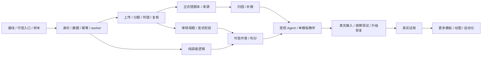

# 智能学习系统开发任务与验收清单

版本：DD-1.0；日期：2026-11-02。  

当前执行状态已从本设计快照更新：独立 V1 服务和本地隔离验收已实现，当前结果/真实阻塞以 `docs/goal/TASKS.json`、`docs/goal/BLOCKERS.md` 与 `docs/verification/` 为准。本文任务表和验收场景保留为原始验收契约，不代表每项当前已通过。
对应规格：[设计开发总文档](DESIGN_DEVELOPMENT_SPEC.md)。  
历史快照（2026-11-02）：独立学习服务已实现并验证一组 S1–S4 的本地确定性闭环（37 项测试、schema revision 3、生产模式独立 Compose 宿主 HTTP 与不删卷重启恢复）。本表保留原始工作包契约；当前技术事实以 `docs/goal/TASKS.json`、`docs/goal/STATUS.md`、`docs/goal/BLOCKERS.md` 和 `docs/verification/` 为准。当前本地回归最近一次为 78 passed、schema revision 6；隔离 Open WebUI Tool 注册和 trusted-header 浏览器 Tools 页面读取已验证，独立 `/ui` 测验闭环见 `docs/verification/browser-test-workbench-2026-11-03.md`，上传→复核→确认→错题本浏览器复验见 `docs/verification/import-browser-recheck-2026-11-03.md`。真实模型 tool call/最终浏览器可信回调、真实 provider、人工标注与 T23 仍未完成，不能以合成证据替代。

## 1. 交付原则

- 在现有 Open WebUI 项目内增加独立学习服务；不新建无关项目，不改官方容器内部源码，不直接写 `webui.db`。
- 按完整功能链逐步交付：先可追溯地收题，再可靠地教学与复测；整卷导入优先于批量扩展视觉内容。
- 每个工作包交付代码、迁移/契约、必要测试及简短证据记录；“接口返回成功”不能替代对最终状态和原始资料的检查。
- 样本、提供商与真实 UI 未验证前，不把模拟数据通过说成正式集成完成。文档不授权对正式数据执行升级、删除或不可逆迁移。

## 2. 阶段与旧规划映射

S 编号只用于本清单的开发顺序，不改变主规划 G0–G4 的质量门槛，也不是复习卡的 stage。

| 阶段 | 可审阅成果 | 主要工作包 | 与既有规划关系 | 离开阶段的条件 |
| --- | --- | --- | --- | --- |
| S0 基线与可行性 | 可恢复基线、可信入口选择、样本与模型实测结果 | T01–T05 | P0、U0；验证 G0 | 身份/回调/附件、模型连接、恢复和质量评估方法明确；失败项有收敛范围 |
| S1 服务基础 | 授权、数据库、挑战、幂等、附件与可恢复任务 | T06–T08；T15 可随后独立开发 | P1 | 多学习者隔离和并发故障用例通过 |
| S2 上传到错题本 | 多图/PDF、分题判错、批量确认和来源追溯 | T09–T12 | U1、U2；共用 P2/P3 能力 | 从整份资料到正式错题可实际跑通，未知不误判，重复不多记 |
| S3 学习复习闭环 | 归因、变式、调度、可信测验、Agent、单模板 | T13–T20 | P2/P3、U3、M1/M3 的核心部分 | 干净题面→原始作答→服务判分→一次调度生效；教学与测验隔离 |
| S4 发布与真实试用 | 故障恢复、兼容演练、运行说明和试用报告 | T21–T23 | P3/P4、U3；完成 G3/G4 | 受限验收后可开放试用，记录问题和实测指标 |
| S5 内容与自动化扩展 | 三模板、视频/GIF、策略化自动入库 | T24–T26 | M2/M4、U4、部分 P5 | 每项独立验收，不倒退核心授权和调度规则 |

无依赖的工作可以在开发安排中并行，例如 S1 完成后调度纯逻辑与上传处理可分别推进；不因此取消最终的端到端验收。

## 3. 工作包

验收编号 QA01–QA17 定义见总文档。责任类别是所需角色，不虚构具体人员。小团队可由同一开发者承担实现，但学科参考判定应由有能力的内容审核人提供。

| ID | 工作内容与交付物 | 前置 | 验收证据 | 状态 |
| --- | --- | --- | --- | --- |
| T01 | 复核运行镜像、目录与扩展；建立代码版本管理及敏感文件排除清单；保存脱敏 manifest | 无 | 与既有快照差异明确；不提交 data、密钥、附件与备份 | 已实现 |
| T02 | 一致性备份和旧版恢复；明确账号、教材原件、附件、向量索引、配置与密钥集合 | T01 | QA15：独立目录恢复成功，来源资料可读，耗时记录 | 已验证（本地隔离） |
| T03 | 原生 Tools 可信身份、输入/确认、取消/超时/断线、真实附件权限探针；决定批量复核承载方案 | T01 | QA01/QA08：真实回调与错误对象测试；后备页面如启用有完整认证设计 | 待验证 |
| T04 | 课程和母题目录、整卷标注样本、参考答案、小问/跨页/模糊/冲突样本；拆分开发与验收集 | T01 | QA03/QA04/QA07：文件与标注清单、题型覆盖、质量标准及审核人 | 待准备 |
| T05 | 文本/视觉/OCR/检索连接探针，schema 约束、超时与预算，明确外发范围 | T01、T04 | 一次真实受控调用及失败路径；名称配置不当作接口可用证据 | 待验证 |
| T06 | 独立服务骨架、存储模型与迁移、账号身份映射、学习者授权、课程/目标字典 | T01、T04 | QA01：两学习者权限；新库迁移与旧数据升级演练；版本可查 | 已验证（本地） |
| T07 | 可信命令通道、挑战、版本锁、幂等、错误结构和会话恢复；按需实现后备 UI 认证 | T03、T06 | QA01/QA05/QA08：伪造/重放/过期/换人/同键异载荷全部拒绝 | 已验证（本地） |
| T08 | 附件存储与上传、限额/解码检查；jobs 原子领取、租约/心跳、取消、有限重试 | T06、T07 | QA02/QA14：文件和任务状态可恢复；迟到 worker 无法落结果 | 已验证（本地） |
| T09 | PDF/图像预处理、页序、分题、区域定位、跨页和小问；原始转写与规范化分离 | T04、T05、T08 | QA03：逐页覆盖与标注对照；失败区域可见，不丢原件 | 已实现（真实质量待验证） |
| T10 | 批改证据、参考答案映射、五类判定、支持题型验证器、争议路由 | T09 | QA04：空白不误判错、红笔不等于叉、错版/冲突强制复核 | 已实现（人工覆盖待验证） |
| T11 | 原图对照复核界面，拆分/合并/修正，冻结选中集合，可信批量确认及部分失败恢复 | T07、T09、T10 | QA05：并发/重复/旧 revision/取消测试；实际计数与库一致 | 已验证（本地） |
| T12 | 错题本、来源发生记录、重复提示、撤回与归档、导出/删除，关联目标的任务请求 | T06、T11 | QA05/QA13：每条回查原卷；真实再错保留；撤回不误删后续证据 | 已实现（真实资料待验证） |
| T13 | 证据归因、澄清、补救建议、诊断版本与依据变更失效；失败保留错题 | T05、T10、T12 | QA06：结构校验、引用存在、缺步骤不补造、审核状态可查 | 已实现（provider 待验证） |
| T14 | 审核母题与变式约束、程序验证/人工审核、题目答案冻结和投放白名单 | T04、T05、T10 | QA07：无解/条件遗漏/答案错误/超纲候选被拦截 | 已实现（人工题库待验证） |
| T15 | interval-v1 纯逻辑、唯一复习目标、今日队列、时间预算、维护门槛与证据统计 | T06 | QA09/QA10：固定时钟日期链与边界；导入事件不改变既有阶段 | 已验证（本地） |
| T16 | 测验预留与干净题面、可信原始答案、辅助暴露门禁、取消/恢复与 pending 状态 | T07、T14、T15 | QA08：无客户端答案；原答保真；已提交后的反馈不污染原资格 | 已实现（独立 `/ui` Chromium 合成链路已验证；真实 Open WebUI 待验证） |
| T17 | 服务端判分与一次性调度提交、待复核替题、评分修订及冻结规则重放 | T10、T16 | QA08/QA09：并发至多一次；迟到/补偿/替题不双重晋阶 | 已验证（本地） |
| T18 | 单编排器、工具允许清单、学习/测验模式、步骤与预算限制、失败回退 | T05、T13、T15、T16、T17 | QA11：模型不能提交最终答案或批准；无新证据能停止并恢复任务 | 已实现（真实 provider 待验证） |
| T19 | 正式数轴模板、素材注册与合法参数、发布/发放暴露记录、手机/减少动态效果及展示探针 | T07、T08、T13、T17 | QA12：复用原型计算检查并增加正式接口/权限/暴露测试；绘图适配单独验证 | 已验证（本地） |
| T20 | 薄 Tools 全流程接入、学习教练配置、今日任务/错题本/上传入口和必要交互绑定 | T03、T11、T12、T16、T18、T19 | QA01–QA12：真实入口完整链路；正式 UI 与模型权限分开 | 已实现（真实 Open WebUI 待验证） |
| T21 | 故障注入、日志脱敏、运行指标、费用/队列告警、资料生命周期与支持手册 | T11、T12、T17、T18、T19 | QA13/QA14：模型/worker/磁盘/数据库故障不会留下半完成成绩 | 已实现（确定性覆盖；真实进程/对象存储/provider 故障待验证） |
| T22 | 隔离副本、候选版本兼容矩阵、正式发布清单、维护窗口与恢复演练 | T02、T20、T21 | QA15：无正式副作用；配置/原件/错题/卡片恢复对账 | 已实现（revision 7 独立 Compose 启动/恢复/重启已验证；真实 Open WebUI/正式切换待验证） |
| T23 | 小范围真实试用、人工抽检、任务预算调整、问题修订与试用报告 | T22 | G4：独立/辅助/待复核分别统计，含样本量、问题与未覆盖范围 | 试用准备见 `docs/verification/trial-readiness-2026-11-03.md`；启动阻塞于真实授权与条件 |
| T24 | 等式同操作、十进制分组模板；按错因选素材；情境绘图受控接入 | T19、T23 | QA12：三模板的数值/图文与各年级表述重新验收 | 后续 |
| T25 | 隔离视频/GIF 导出、分镜审核、依赖固定、素材缓存与静态替代 | T24 | QA16：资源限制、公式一致、访问隔离和可追溯版本 | 后续 |
| T26 | 有权启用的自动入库策略、更多题型/学科；校准、冲突降级和撤回 | T10、T11、T23 | QA17：独立样本实测、按范围放行；模型不能自设阈值 | 后续 |

## 4. 关键依赖与开发注意点

- T15 可以在导入工作进行时独立开发，不能等视觉内容完成后才明确调度语义。
- T11 解决批量复核，T16 解决测验作答，两者复用 T07 的可信输入但有不同操作挑战，不可串用。
- T12 只提交目标关联/建卡任务；T15 的调度模块决定是否新建及到期时间。导入来源不调用“失败清零”。
- T14 与 T10 共享验证基础设施，但教师卷面批改、模型候选答案和独立测验成绩是不同证据类别。
- T19 的教学答案可公开在教学素材中；T16 的标准答案不能暴露。教学素材不能原样兼任正式评测页面。
- T22 不与 OCR、embedding、调度规则或密钥轮换同时升级，避免失败后无法区分原因。

## 5. 验收场景清单

以下清单是必须执行的用例，不代表已经通过。

### 5.1 上传与错题收集

- [ ] 两张不同方向照片能正确排序/旋转，原图和变换关系保留。
- [ ] 多页 PDF 中某页失败时，前端展示失败页与未覆盖区域，不能报全卷完成。
- [ ] 大题含多个小问、跨页答题与共用材料时，入库小问仍能看到完整题意。
- [ ] 红色下划线、对勾、改正答案、扣分、空白和相互矛盾批注分流正确。
- [ ] 参考答案错版或选项顺序变化时不会机械比对后入库。
- [ ] 修改转写后旧判定/确认失效；模型迟到结果不会覆盖人工修订。
- [ ] 同批重试、双标签页确认、同图再上传不重复新增来源；真实再做仍可记录。
- [ ] 未知/不支持题型可复核和人工整理，模型失败不等于判正确或判错误。

### 5.2 复习与测验

- [ ] 2026-11-02 建卡的默认日期链与设计一致，跨午夜与时区变更有测试。
- [ ] 提前练习、导入旧卷、看动画、普通聊天中的“答对了”均不晋阶。
- [ ] 取消、超时、非空错误对象与模型伪造的确认不能产生最终作答。
- [ ] 相同 raw_answer 请求重传只保存一次；相同幂等键不同内容拒绝。
- [ ] 最终判分等待期间可恢复；迟到/重复结果不会再次更新卡片。
- [ ] 获得提示前已标辅助；已提交答案之后正常反馈只影响后续暴露时间。
- [ ] 活动测验期间从错题本、导入卷面或素材入口取答案，不能绕过暴露规则。
- [x] stage 5 维护条件包含跨日、变式及最近暴露间隔；缺一项不能进入维护（服务端 gate 与 practice 隔离已验证，证据：`docs/verification/maintenance-gate-2026-11-03.md`）。
- [ ] 复核替题后原题恢复判分不会与替代题双重晋阶。

### 5.3 Agent 与素材

- [ ] 工具允许清单没有最终确认、最终答案提交、批准改分或权限变更。
- [ ] 达到工具次数、预算或超时上限时停止并显示可继续的任务状态。
- [ ] 诊断引用实际学生步骤，无法解释时请求澄清，不输出人格标签。
- [ ] 视觉参数超界拒绝，数轴/公式/文本一致，可暂停、逐步、重置与减少动态效果。
- [ ] 客户端观看事件不直接产生有效成绩，私有素材不能跨学习者读取。
- [ ] 原生展示失败时有静态/文字回退，页面能显示不被当作可信评测验收。

### 5.4 运维与恢复

- [ ] worker 在外部调用后、提交前崩溃，重试不会重复入库或晋阶。
- [ ] 取消后的迟到调用、过期租约、数据库失败和磁盘写失败均有明确结果。
- [ ] 导出/删除范围受授权约束；恢复不会重新公开已删除私有资料。
- [ ] 演练副本首次启动前已阻断正式学习 API、外部模型/通知和正式存储。
- [ ] 升级前后账号、配置、教材关联、原卷/区域、错题与复习状态对账通过。
- [ ] 数据库迁移后通过匹配备份恢复旧版本；不以只换镜像作为成功恢复证据。

## 6. 测试数据与质量报告

开发者维护模拟提供商、可控时钟、合成学习者和权限测试；内容审核者维护题目参考判定。真实学生资料只有经过适当授权和脱敏才进入测试，不能提交到代码库。

R2 中约 30 道参考样题和约 20 道审核变式只能作为原基础试点起点，不能覆盖整卷导入验收。整卷样本需补齐所有页与所有题的标注，单列未识别题、失败页、部分错误与弃判项。按资料/母题拆开开发和验收集合。

每份质量报告至少包含：样本来源范围、模型/OCR/提示词/模板版本、总文档/页/题数量、各题型量、分题完整率、关键符号正确率、判错精确率、错题召回率、待复核比例、端到端耗时和费用。正确率不能排除失败页后再计算成“全卷正确率”。

入库/判分覆盖阈值在 S0 基于样本和使用目标明确，不写未经测量的 95% 或 99% 承诺；未达标题型强制走复核。确定性权限、幂等与调度测试不允许用统计阈值代替全部通过。

## 7. 工期与决策记录

旧估算 11~17 人日仅为 R2 基础闭环；12~19 人日包含当时的试用修订，均不包含本次完整上传与媒体扩展。不得把旧区间写进新完整范围的交付承诺。

S0 后按 T01–T23 逐项估算，记录最佳/常见/困难情况及不确定依赖，共用的身份、worker、题目验证与复核只计一次。需要后备复核/测验页面、识别质量不达标或样题审核无法及时提供时，单列范围/工期影响。T24–T26 分开估算与发布。

真实试用沿用至少 7–14 天的可用性观察建议；它不能代替 30 天间隔和长期保持观察，不与开发人日相加成为日历承诺。

| 决策编号 | S0 需要确定的内容 | 记录位置 |
| --- | --- | --- |
| DEC01 | 运行基线、数据目录、备份集合与恢复结果 | 发布 manifest / 恢复报告 |
| DEC02 | 原生交互是否承载批量复核；后备页面认证方案 | 交互探针 / API 契约 |
| DEC03 | 模型/OCR 提供商、外发范围、费用和资源上限 | 脱敏配置 / 质量报告 |
| DEC04 | 支持题型、课程版本、标注集、审核人、质量门槛 | 课程/样本 manifest |
| DEC05 | 学习者授权、保留/删除/备份策略与提醒范围 | 权限与生命周期记录 |

## 8. 开发完成定义

一个工作包完成必须有：实现位置、对应规格/契约版本、必要测试命令与结果、已知限制、样本/提供商是否模拟、迁移或配置变更说明。证据记录使用实际日期，不复制规划中的“待通过”为“已通过”。

推荐证据目录为 `docs/verification/`，开发阶段再创建；按工作包存不含个人资料的报告，敏感原始证据放受控测试存储，不把学生卷面嵌进公共文档。

V1 发布前 T01–T22 的必需验收完成，T23 形成真实试用结论；核心范围尚未完成时不能仅凭离线交互页面宣布上线。当前 T01–T22 的实现、确定性/隔离证据和真实外部未满足项以 `docs/goal/TASKS.json`、`docs/goal/BLOCKERS.md` 与 `docs/verification/` 为准；T03/T04/T05/T20/T21 的真实前置和 T23 仍未完成，T24–T26 保持后续。
