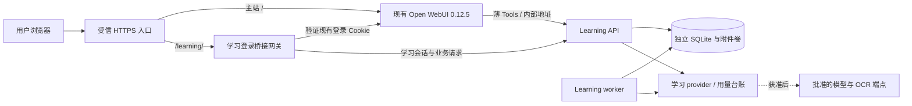

# DD-1.0 复用现有 Open WebUI：规划方案

日期：2026-11-04（Asia/Shanghai）。本方案依据用户已确认的本机 Docker Compose、内置账号和 HTTP 访问地址编写。**初始规划已转入第一批本地开发，详见[实现说明](04-LOCAL-IMPLEMENTATION-2026-11-04.md)；生产切换、真实模型/OCR调用及试用没有执行。** 技术细则见 [技术开发文档](02-TECHNICAL-DESIGN-2026-11-04.md)，排期见 [工作计划](03-WORK-PLAN-2026-11-04.md)。

用户已确认沿用IP，HTTPS开发目标固定为 `https://172.19.116.53`（443、IP SAN证书）；证书/客户端信任、IP稳定性与HTTP53001策略待落实。只读443无监听不等于正式端口验收。

## 1. 目标与范围

复用现有 Open WebUI 的账号、聊天界面及 Tools 承载能力，为完整 V1 提供上传复核、错题本、今日复习、测验、诊断和数轴教学入口。学习服务独立保存资料、作答、判分、调度和审核证据；账号关联通过不可变 Open WebUI 用户 ID 建立。

生产使用同一个现有 Open WebUI 容器。独立的隔离验证环境用于上线前组合验证，不成为另一套生产 WebUI。当前正式教学范围仍为 `signed_number_subtraction`；Office 支持仍限 DOCX/XLSX 本地结构化文本。整卷质量、人工审核及真实 provider 保留完整 V1 原门槛，T24–T26 不启动。

## 2. 已确认现状

| 项目 | 已确认事实 | 证据边界 |
| --- | --- | --- |
| 现有入口 | `http://172.19.116.53:53001/` | 用户提供；不是已具备的 HTTPS 学习入口 |
| 运行方式 | 本机 Docker Compose | 用户提供，Compose 标签复核一致 |
| 容器/项目/服务 | `open-webui` / `open-webui` / `open-webui` | 指定容器元数据；未读取根 Compose 文件 |
| 运行版本 | Open WebUI 0.12.5，running/healthy | `/api/version` 与容器状态；不构成学习功能验收 |
| 端口与网络 | 宿主 53001 → 容器 8080；网络 `open-webui_default` | 端口发布在 IPv4/IPv6 全接口；没有修改网络 |
| WebUI 数据 | 本项目 `data/` → `/app/backend/data` | 只看挂载元数据，未读取数据内容或密钥库 |
| 登录 | 内置账号；源码支持 HttpOnly `token` Cookie、`GET /api/v1/auths/` | 仅源码协议审阅；正式登录、Cookie 实际属性与注销链路未验证 |
| 学习服务 | schema 9，OpenAPI 61/22；provider、费用台账、浏览器会话本地实现 | 102 项聚焦通过；101 是旧全量基线，合成证据不等于真实验收 |
| 发布物 | 29 文件固定源码候选；学习镜像 digest 尚无 | 源码包不是已构建镜像，P0 仍为 schema 7 |

现有 WebUI 镜像 digest 与部署输入记录见 [部署输入](deployment-inputs-2026-11-04.json)。不拉取 `:main` 来替换现有容器，也不把已有 WebUI 镜像当作新学习服务镜像。

## 3. 目标架构

API 与 worker 使用同一学习数据卷；WebUI 的 `data/` 仍由 WebUI 拥有。桥接网关只验证现有登录并转发授权请求，不复制 WebUI 用户库、密码或签名密钥。Tools 使用内部 API 地址，浏览器通过 HTTPS `/learning/` 访问。

学习栈使用独立 Compose project，部署文件位于拟新增的 `deploy/open-webui-reuse/`。现有 `open-webui_default` 作为网关、HTTPS 代理与 WebUI 的内部连接网络；学习 API/worker 留在独立 internal 网络。正式接入时需明确 WebUI 到学习 API 的专用网络连接和恢复后重连方式，保留 WebUI 原网络与默认路由。网络连接、Tools 注册和代理上线均属于未来生产变更。

## 4. HTTP 入口的迁移方案

推荐新增一个受信 HTTPS origin，默认 443，主站路由仍指向现有容器 `open-webui:8080`。HTTPS origin 可以使用已确认的内网域名；若使用 `https://172.19.116.53`，证书须包含该 IP 的 SAN，并在试用客户端建立信任。不能把浏览器忽略证书错误当作 HTTPS 验收。

域名/证书方案、443 是否可用和本机 IP 是否稳定尚待确认。此 IP 是用户提供的当前地址，本方案不推断其在主机重启或网络切换后固定不变。若 443 已占用，先确定实际 origin；当前代码拒绝非 443 HTTPS origin，如确需其他 HTTPS 端口，必须明确开发与验证相应配置限制。

现有 `53001` 端口本次不改动。正式试用须通过 HTTPS；旧 HTTP 登录入口最终如何限制、转发或退出，由生产配置和维护窗口审阅决定，不能让旧明文登录入口成为新会话的旁路。从旧 HTTP 地址切换到不同 HTTPS 主机名时，需要在新入口首次登录一次；复用的是同一套内置账号，不承诺跨 origin 搬运旧 Cookie。

## 5. 用户流程

| 角色/入口 | 用户操作 | 权威结果 |
| --- | --- | --- |
| 登录 | 在 HTTPS 主站登录现有内置账号，打开“学习工作台” | 网关验证 WebUI 登录并换取学习会话；未知身份引导联系管理员 |
| 学习者选择 | 从授权列表选择学习者 | 服务端保存上下文；两端显示一致，切换使旧挑战失效 |
| 资料导入 | 在学习工作台上传原件，检查来源页，人工修正与确认 | API 保存原件、候选、判定证据和错题来源；聊天文本不代替最终确认 |
| 今日复习/测验 | 打开任务，阅读干净题面，提交原始答案 | 服务端挑战校验、判分、一次调度；提示和辅助暴露继续受控 |
| 学习聊天 | 在 WebUI 学习会话中调用批准的薄 Tools | 模型只获得允许的最小结果；诊断/变式保持待审核 |
| 教师/审核人 | 审核诊断、变式及争议；按范围发布冻结题目 | 留存审核证据，批准与投放由人工权限完成 |
| 管理员 | 维护绑定、预算、告警、备份和停用 | 管理权限来自学习服务授权，WebUI admin 不自动成为学习 admin |

第一版入口可采用管理员维护的固定学习链接或目标版本支持的快捷入口，工作台在独立页面打开。具体导航扩展能力在 W01 核对；不假定当前版本已有某个侧栏扩展。普通用户流程隐藏账号 ID、nonce、批次 ID、共享密钥和技术参数。

## 6. 已有实现与待开发差异

| 能力 | 可复用 | 本轮方案明确的开发缺口 |
| --- | --- | --- |
| 原生 Tools | 11 个公开方法、宿主 `__user__`、Valves/UserValves、120 秒回调边界 | 正式注册/访问范围、返回字段最小化、工作台链接、与浏览器统一学习者上下文 |
| 浏览器会话 | 独立 HS256 短声明、HttpOnly、CSRF、Origin、撤销 | WebUI Cookie 验证网关、来源身份持久化、解绑后即时拒绝及 WebUI 登录变化校验 |
| 工作台 | 上传复核、错题本、测验等本地流程 | 公共路径前缀、登录链接、页图/资源请求、恢复缓存的身份隔离及产品入口整理 |
| 学习用量/费用 | 逐次预留、限额、暂停、对账 | WebUI 聊天模型费用另行控制；现场告警/恢复与真实报价、账单验收 |
| 变式 | 程序验证的数轴整数模板草稿 | 正式人工审核、冻结版本和投放链路；当前生产关闭的 seed 端点不能用于发布 |
| 打包/恢复 | 源码封包、SQLite/WAL 与附件恢复工具 | 固定镜像、新 Compose/代理配置、目标组合恢复与完整切换演练 |

现有学习台账不统计 Open WebUI 自身聊天模型费用。Tools 输出也可能被 WebUI 发送给聊天模型，因此 OCR mock 或学习模型外发关闭不代表聊天通道没有外发。聊天模型、学习诊断/变式、OCR 三条通道分别落实资料范围、网络和预算；本次均不发起真实调用。

## 7. 发布与验收顺序

| 阶段 | 完成内容 | 进入条件 |
| --- | --- | --- |
| 环境与入口设计 | HTTPS、证书信任、固定 origin、网络与现有配置的最小变更清单 | 只读事实、已确认输入和具体配置候选 |
| 本地工程 | 网关、绑定、路径、Tools、变式审核发布、镜像和运行说明 | 可在合成环境开发；保持外发关闭 |
| 新隔离组合 | 当前新代码的认证/路径/迁移/工作台和恢复验证 | 新目录/project/独立卷，固定镜像与版本；不覆盖旧 P0 |
| 真实链路与质量 | P1 tool call/最终回调、P3 provider、P4 人工质量 | 对应真实调用限制明确改变，模型/预算/资料/审核人到位 |
| 生产接入 | 现有 WebUI 的代理、网络、Tools 与新学习栈接入 | 审阅具体发布物、配置差异、备份、停用/恢复与维护窗口，再明确授权 |
| 小范围真实试用 | 真实参与者每日使用、人工抽检与问题处置 | 同意、范围、预算与启动条件齐备；7–14 自然日观察另计 |

工作包可以先开发独立部分；真实门槛不会因文档、合成测试或 loader 通过而解除。已有四格式持久化和旧 P0 证据复用，只有相关代码/运行版本变化时做必要回归。

## 8. 运行与恢复策略

首发交付架构沿用当前 SQLite/WAL 与本地附件卷，作为待确认的实际运行范围；容量以实际并发、资料页数、worker 队列和磁盘测试确定，不填造吞吐或 RPO/RTO。外部数据库/对象存储是否使用及相应 QA 项适用性仍需明确架构复核，本方案不擅自删掉未验收项。

学习服务故障时，停用学习入口和 Tools，WebUI 原聊天路由仍应可用；通过真实组合验收这一故障隔离。上线前排空任务、暂停 provider，制作数据库/附件/删除记录/配置与秘密引用的一致性恢复集合。上线后已有新写入时，不能直接覆盖为旧快照而声称无损；优先停写、保存现场，再按已验证的前向修复或数据恢复方案处理。

学习恢复会撤销会话、暂停 provider，并保留未知费用占用。WebUI 独立数据也需安排受控备份与恢复责任；本次未读取或备份其密钥库，现有挂载元数据不等于备份证据。

## 9. 当前授权与待确认输入

用户已经确认复用现有部署，并授权生成规划、技术文档和工作计划。此选择不构成生产变更、真实 API、真实学生资料外发或试用启动授权。先前禁止事项继续有效。

尚待确定：HTTPS 域名或 IP 证书方案/客户端信任、443 可用性、旧 HTTP 入口处理、管理员和学习者绑定名单、试用模型与三通道预算、资料/审核人与质量阈值、生产容量/备份窗口、试用人数和时段。输入可逐步补齐，秘密只在运行时提供，不写进本计划。

工程排期以 [W01–W14 工作计划](03-WORK-PLAN-2026-11-04.md) 为准。当前 [T01–T26 台账](../goal/TASKS.json)、[QA 矩阵](../verification/qa-matrix-2026-11-03.md) 和 [试用清单](../verification/trial-readiness-2026-11-03.md) 保持原验收定义。
