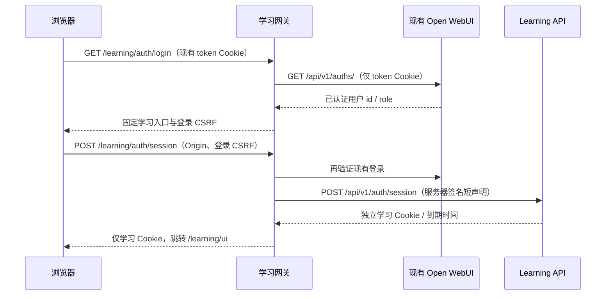

# DD-1.0 复用现有 Open WebUI：技术开发文档

W07–W10实际配置/构建/隔离恢复进度以[第三批说明](06-RUNTIME-RECOVERY-2026-11-04.md)为准；本文其余“尚未实现”条款保留设计历史，正式接入/真实验收门槛不变。

日期：2026-11-04（Asia/Shanghai）。状态：**W04/W05/W06已有本地合成实现，目标组合/生产未部署**。当前schema11 /OpenAPI66/24；[第二批操作说明](05-WORKBENCH-TOOLS-REVIEW-2026-11-04.md)描述最终实现，本文其余拟议条款仍是目标设计。首批历史：登录网关、身份CLI、migration010、来源会话/共享上下文及前缀基础已实现并有本地合成证据；详见[实际实现说明](04-LOCAL-IMPLEMENTATION-2026-11-04.md)。其余Tools、审核发布、部署配置与真实验收仍按本文设计推进。当前源码schema10 / OpenAPI61 paths、22 schemas；初始设计基线schema9已保留在旧候选。

关联：[规划方案](01-PLANNING-2026-11-04.md)、[工作计划](03-WORK-PLAN-2026-11-04.md)、[当前 API 契约](../contracts/openapi-v1.json)、[现有 Tools](../OPEN_WEBUI_TOOLS_INTEGRATION.md)、[provider 配置](../PROVIDER_CONFIGURATION.md)。

## 1. 部署基线与设计原则

当前本机容器 `open-webui` 为 0.12.5，Compose project/service 均为 `open-webui`，网络为 `open-webui_default`，宿主 `53001` 映射容器 `8080`。现有挂载 `data/` 仅由 WebUI 使用。镜像 digest 已只读固定于 [部署输入](deployment-inputs-2026-11-04.json)。

以独立学习栈接入现有容器，不在学习服务导入 `open_webui.*`，不直接读取 WebUI 数据库、密码或签名密钥，不把完整 OpenAPI 注册为模型工具。内置账号的验证交给 WebUI 自身认证接口。正式业务、审核、判分和调度的权限由学习服务继续控制。

本轮未创建生产Compose、代理配置或运行密钥；已实现文件与仍待开发的清单在下文和实际实现说明中列出。根 `docker-compose.yml`、`batch_ingest.py` 和正式密钥库保持禁读/禁改。

## 2. 公共路由与 HTTPS

| 浏览器路由 | 处理服务 | 说明 |
| --- | --- | --- |
| `/`、WebUI 原 API/WebSocket/资源 | 现有 WebUI | HTTPS 代理转发到 `open-webui:8080`，保留原路由语义 |
| `/learning/auth/login` | 新登录桥接网关 | 现有账号登录状态检查及带登录 CSRF 的会话建立页 |
| `POST /learning/auth/session` | 新登录桥接网关 | 验证现有登录后，仅在服务器间交换学习声明 |
| `/learning/ui` | 网关 → Learning API `/ui` | 学习工作台，先验证 WebUI 身份，再验证学习会话 |
| `/learning/api/v1/...` | 网关 → Learning API `/api/v1/...` | 固定前缀剥离、身份一致性与路径白名单 |
| `/learning/api/v1/auth/session` 的 POST | 不对浏览器开放 | 现有学习声明交换接口仅供网关的内部 HTTP 调用 |
| `/learning/internal/...`、调试文档 | 不公开 | 正式 bootstrap/seed 保持关闭，不做通配代理 |

现有工作台 `call(path)`、页图读取与登录链接使用根路径。拟新增 `LEARNING_PUBLIC_BASE_PATH=/learning`，并由服务器输出 JSON 编码后的固定值；所有 fetch、页资产、登录、错误恢复和静态资源 URL 统一由 URL 构造函数生成。代理剥离前缀后服务端内部路由仍为 `/api/v1/...`，Tools 继续使用内部 base URL，不能把 `/learning` 错误加入内部 API 路径。

不从任意 `Host` 或客户端 `X-Forwarded-Prefix` 推导该值；拒绝 `..`、重复斜线、外部 origin、协议相对 URL。代理仅信任配置的前缀与 upstream。表单和浏览器状态缓存以实际 origin、身份、学习者与上下文版本隔离，退出或身份变化后清理旧上下文，原始作答/原件不写浏览器持久缓存。

当前 `BrowserSessions.configured()` 要求 origin 为 HTTPS，端口为默认值或 443，无 path/query/fragment；Secure Cookie 在现有 `http://172.19.116.53:53001` 上无法按本设计工作。推荐 TLS 代理发布受信 443 入口；域名或 IP SAN 证书、客户端 CA 信任和 IP 稳定性需确认。HTTP 53001 的正式限制/退出方案属于上线配置，不能直接改映射。确需其他 HTTPS 端口时，先在配置校验中开发明确的允许规则与回归。

当前 Cookie 使用 `__Host-dd_learning_session` 和 `__Host-dd_learning_csrf`，属性为 Secure、SameSite=Strict、Path=/，不设置 Domain；会话 Cookie 为 HttpOnly，CSRF Cookie 可由工作台读取。**保留 Path=/，不能让代理把 `__Host-` Cookie 改为 Path=/learning。** 同 origin 的 WebUI 与学习页面属于同一受信浏览器域；网关仅向对应 upstream 转发该服务需要的 Cookie。

## 3. 内置账号登录桥接

### 3.1 当前源码协议事实

已只读审阅现有容器内 `open_webui/routers/auths.py` 和 `open_webui/utils/auth.py`，未导入模块、查询用户或读取实际 Cookie：

- `GET /api/v1/auths/` 使用 `get_human_user` 依赖；认证工具函数支持 `token` Cookie。
- 当前路由返回 `id`、`role`、token 和个人资料，且可能返回 `Set-Cookie: token=...`。
- 内置登录/注销源码设置或删除 `token` Cookie；Secure/SameSite 来自运行配置，**实际值没有读取或实测**。

网关只提取经过上游认证的字符串 `id` 和准入状态。禁止记录/透传上游认证响应的 token、邮箱、个人资料或 `Set-Cookie`。Cookie 名称可固定为当前 `token`，但登录、过期、pending、注销等实际行为仍需在获准的隔离账号链路中验证。不能用源码存在代替已验收 SSO。

### 3.2 会话建立流程



实现要求：

1. WebUI upstream 固定为内部 `http://open-webui:8080`，认证 path 固定 `/api/v1/auths/`；禁止用户控制 upstream、重定向和环境代理。建议初版请求/读取总截止 3 秒、响应上限 64 KiB、认证不自动重试；实际参数在组合验收后固定。
2. 浏览器仅使用现有 Cookie；不索取密码，不读取 localStorage token，不接受浏览器提交的 `sub/account_id/role` 或永久 API key。没有 Cookie 时引导现有 HTTPS WebUI 登录页面，再回到固定学习链接；登录页面导航路径及返回参数能力须验证，不能假定任意 return URL 可用。
3. 只接受认证成功、非空字符串用户 ID 与允许进入的 WebUI 人类账号状态；`pending`、停用、过期、401、格式错误、超时均拒绝学习访问。WebUI `admin/user` 只是入口准入，不能映射成学习业务角色。
4. `POST /learning/auth/session` 同时校验固定 HTTPS Origin、独立登录 CSRF 与其所绑定的当前 WebUI 会话。短登录 nonce 不含密码/永久凭据，有期限与重放限制；跨站请求不能替他人建立学习会话。
5. 网关在服务器端生成 HS256 JWT，header 与 claims 严格符合现有交换接口。建议寿命 60 秒，硬上限仍为 120 秒，随机一次性 `jti`；JWT不写 URL、浏览器、模型返回、日志或 Tool Valves。
6. 网关调用 Learning API 的内部会话交换，设置配置中的 Origin。只转发学习服务签发的两个明确 Cookie，响应正文只返回状态/到期时间；不要转发任何 WebUI Cookie。
7. 未绑定身份返回可处理的 401/未知身份状态，由管理员建立绑定；禁止自动按邮箱匹配、创建管理员或绑定任意学习者。

JWT 严格字段示意（不是有效令牌或可运行登录请求）：

```json
{"iss":"dd-learning-gateway-installation-id","aud":"dd-learning-v1","sub":"verified-openwebui-user-id","iat":0,"exp":60,"jti":"illustrative-single-use-id"}
```

JWT `iss` 为网关发行者；数据库绑定中的 issuer 为 Open WebUI 安装标识，两者用途不同。网关签名密钥与 admin/adapter 密钥独立，现有 WebUI 登录签名密钥不需要复制给学习服务。

### 3.3 每次业务访问与退出

所有 `/learning/` 受保护请求都由网关重新验证 WebUI Cookie，初版关闭认证结果缓存。学习 API 同时验证自己的会话和当前绑定；网关比较 WebUI 用户 ID 与学习会话来源身份，身份切换不允许沿用前一个账号的学习会话。

migration010已保存会话来源provider/issuer/subject；认证逐次复核当前绑定仍指向原account，迁移撤销无来源的旧会话。内部GET会话返回来源供网关比较，网关对浏览器返回时删除identity字段。以上仅有本地合成验证。

学习退出调用现有 `POST /api/v1/auth/logout`，数据库撤销并删除学习 Cookie；WebUI 的注销保持由其自身处理。WebUI Cookie 消失、过期、账号状态改变或切换到另一个 ID 后，网关的后续学习请求必须拒绝并清理/引导重建学习会话。这里的验收是“旧学习 Cookie 不能继续访问”，不宣称当前已经实现全系统即时注销通知。

WebUI 认证服务故障时，学习请求拒绝访问，原 WebUI 路由不被网关拦截。认证 Cookie、JWT、上游响应和原始资料不进入失败日志。

## 4. 身份绑定、角色与学习者上下文

### 4.1 正式初始化和绑定管理

复用 `accounts`、`identity_bindings`、`learner_access`，以 `(provider, issuer, subject)` 唯一映射 account。subject 取不可变 WebUI 用户 ID，不以显示名/邮箱替代；正式安装 issuer 与隔离安装分开，不能复制合成身份。

现有正式模式下 bootstrap 和 questions seed 为 404。拟新增受控的安装/绑定 CLI，先 validate/dry-run，再由有主机操作权限的管理员在明确目标学习库执行 apply/revoke。最初的课程、知识点、目标、模板和审核母题也通过版本化初始化输入建立，不能临时开启 `LEARNING_DEV_MODE` 暴露 seed 接口。

| 操作 | 约束 |
| --- | --- |
| 绑定 | 验证已有/新建学习账号与学习者，拒绝同身份异 account 冲突；不隐式授予管理权 |
| 授权 | role 只取当前 `learner_access` 的 student/guardian/reviewer/admin；每个学习者单独授权 |
| 解绑/撤权 | 撤销相关会话，重新校验账号上下文，使旧挑战失效；保留资料、作答和审核历史 |
| 审计 | 复用 `audit_events`，记录操作者、对象、变更摘要和结果；不记录密码、Cookie 或原件 |
| 运维管理 | WebUI admin 与学习 admin 分别授权；全局运维/绑定权限须明确边界，不能从某个学习者的 role 推断无限运维权 |

### 4.2 两端统一上下文

当前浏览器把 learner_id 存在会话中，Tool 读取 per-user UserValves，两端未自动同步。拟新增 `account_contexts(account_id, learner_id, revision, updated_at)`，保存该学习账号当前选择；`POST /api/v1/learner-context` 仍由受信 UI、CSRF 和权限校验驱动，新增只读 GET 获取 context/revision。

Tool 在业务调用前读取服务端上下文。UserValves 可作为受信选择的回显/一致性检查，遇到不一致返回“请确认学习者”，不默默选择第一个，也不接受模型传入 account/learner 替换。工作台切换后刷新该服务端上下文；跨标签页用版本变化提示刷新，并使旧挑战失效。没有选择时，先显示授权学习者列表。

浏览器业务请求仅使用学习 Cookie 与 `X-CSRF-Token`；网关删除客户端 `X-Adapter-Secret`、`X-Account-Id`、`X-Trusted-*`、`X-Learner-Id`，新版会话 UI 不再依赖 learner 头覆盖上下文。内部 Tool 通道仍通过 adapter secret/宿主 subject 读取服务器选择，并再次验证 learner_access。

拟新增迁移从当前 009 后接续，至少包含会话来源字段与账号上下文；具体迁移文件名/版本在实施时固定。旧会话撤销、绑定变更审计和上下文恢复要纳入旧库升级、备份恢复、导出/删除生命周期。本地已创建migration010并在合成临时库/恢复副本验证；正式数据库和旧P0没有升级。

## 5. Tools 与学习入口

现有 11 方法和 `start_trusted_interaction` 的四种固定操作继续复用。模型不能覆盖保留 `__user__`/`__event_call__`，不能创建/消费 challenge、提交答案或批准变式。原生回调接受后才按当前 revision 请求并消费挑战；取消/异常/120 秒超时/断线均拒绝，原始答案、nonce、challenge ID 不进入模型返回。

管理员 Valves：内部 API base URL、adapter secret、固定 provider/installation issuer；共享正式 Tool 的 `DD_TRUSTED_SUBJECT` 留空，不设置全局 `DD_ACCOUNT_ID/DD_LEARNER_ID`。WebUI 的实际工具分享、用户组/模型配置能力在目标版本核对，以最小允许账号开放；如果无法可靠限制，不能默认向全部账号公开。

拟增加固定 HTTPS 学习工作台链接及安全的最小结果投影。当前读取类 Tools 会序列化服务返回，因此上线前逐方法审计，禁止把完整原卷、私人原始作答、个人资料或管理 payload 自动送进聊天模型。网页可在已授权工作台显示完整资料；聊天结果只包含实现学习请求所需、获准外发的字段，敏感详情通过工作台读取。显式获准的学科上下文按独立策略处理。

聊天模型由现有 WebUI 配置负责，学习 diagnosis/variant/OCR 则由 Learning 服务配置负责；不能因为 WebUI 已有某个模型就把它当作学习 provider 已接入。学习教练提示词/模型绑定/访问范围使用独立版本配置，保留其他现有聊天配置；导航入口使用已核对的能力或固定链接，不为入口假定必须维护上游源码分支。

## 6. 人工变式审核与发布

以下设计已由schema11本地实现；具体路径、冻结/撤销/幂等与证据以[第二批说明](05-WORKBENCH-TOOLS-REVIEW-2026-11-04.md)为准。正式人工母题/质量和目标组合仍缺。

当前生成结果只在 job 草稿中，正式审核发布尚未联调。拟新增受限审核接口：`POST /api/v1/admin/variant-jobs/{job_id}/review`，只允许对应学习者/目标范围内的 reviewer/admin 操作，并由受信 UI 发起。

请求包含 approve/reject、当前结果指纹、人工审核说明和幂等键；服务端重新校验母题仍批准、目标/学习者范围、整数定义域、程序题干/答案、当前 job 结果。批准时在单事务中记录审核证据并生成冻结 question/version；重复同载荷返回同一个版本，冲突返回 409。拒绝不创建可投放版本。provider 返回的 approval 字段不构成人工审批。

只允许批准版本进入测验题库；撤销或后续修订不能悄悄改写已使用版本/成绩。原始母题、job、审核操作者及版本来源可回查；导出、删除、恢复和维护门槛的审核变式计数继续遵守现有规则。不能用正式模式下关闭的 `/internal/questions` 做发布替代。

## 7. 配置契约与拟新增文件

| 配置/来源 | 状态 | 使用位置 |
| --- | --- | --- |
| `LEARNING_BROWSER_AUTH_*`、`LEARNING_BROWSER_IDENTITY_*`、`LEARNING_BROWSER_ORIGIN` | 现有 | API 验证独立网关声明与绑定；origin 填最终 HTTPS origin |
| `LEARNING_ADAPTER_SECRET` 与 Tool 管理员 Valves | 现有 | 仅内部服务到服务调用，不交浏览器/模型 |
| `LEARNING_PUBLIC_BASE_PATH` | 已本地实现 | `/learning` 浏览器 URL 构造；内部 Tool API 无前缀 |
| `DD_GATEWAY_OPENWEBUI_URL` | 已本地实现 | 固定内部WebUI地址；认证path与token Cookie名是代码常量 |
| `DD_GATEWAY_PUBLIC_ORIGIN` | 已本地实现 | 固定HTTPS origin；返回路径固定为前缀+/ui，未开放任意RETURN_PATH |
| 网关声明密钥 | 运行时新提供 | 独立于WebUI/admin/adapter；登录CSRF为单进程随机nonce哈希，无额外长期CSRF密钥 |
| 模型/OCR 外发、预算/次数/并发 | 现有学习字段，WebUI 聊天控制另行补齐 | 初始 mock、外发关闭、学习预算 0；真实接入须指定三通道许可/预算 |

工程文件清单（网关/CLI/来源/上下文/前缀基础已本地实现，其余待执行）：

- 新增 `learning_service/login_gateway.py`、`learning_service/identity_admin.py` 与受控安装/绑定脚本；网关独立进程，不导入 WebUI 内部模块。
- 修改 `browser_auth.py`、`app.py`、`config.py`、`tools.py` 和新增迁移：来源身份、统一上下文、前缀、安全投影与审核发布。
- 新增 `deploy/open-webui-reuse/compose.learning-sidecar.yml`、HTTPS/网关路由候选、无秘密运行模板、恢复/接入手册；不直接编辑禁读根 Compose。
- 新增网关/路径/绑定/审核发布的针对性测试和组合探针；实际代码改变后更新 OpenAPI、重新在**新目录**封包。

原29文件schema9源码候选保持固定；本轮新35文件schema10源码封包使用新目录，image_digest仍null。Tools/审核/部署完成后还需新的候选与实际镜像，不覆盖旧包或借用P0 hash。

## 8. Docker、网络与发布

使用新的学习 project 和独立学习卷，服务至少包括 learning-api、learning-worker、learning-gateway、HTTPS 代理。API/worker 非开发模式，均接收同一模型/费用配置；health 与 worker 配置一致性纳入启动检查。现有 Compose 没有转发新增模型/浏览器字段，不能直接视作新运行配置。

代理和网关连接 `open-webui_default` 以访问现有 WebUI；API/worker 只连专用 internal 网络。Tool 在现有 WebUI 容器中访问 API 需要将其连接到专用学习网络；新增连接不得替换原网络/默认路由。现有 WebUI 重建后连接可能丢失，需有幂等的重连/核验手册，或者经审阅的持久部署差异；没有这一点不能宣称重启后可用。只连接网络的动作也是未来生产变更。

只公开 TLS 代理入口，学习 API 不发布宿主端口、网关不做开放代理；管理路径另按学习角色受控，`/internal` 关闭。真实出网时需另行实现可审阅的默认拒绝网络控制或专用 egress 方案；internal 网络、endpoint 配置白名单不等于已通过外部网络许可/防火墙验收。

学习镜像固定基础镜像 digest、依赖与应用 digest，记录无缓存构建和目标组合结果；当前原始 Dockerfile 无缓存构建尚未证明成功。现有 WebUI 保留已核对的固定 digest，在本方案内不拉取 `:main` 或顺便升级。上线差异分别记录新增栈、代理、网络、Tool 分享/Valves、秘密引用与数据目标。

## 9. 三通道费用、资料和监控

| 通道 | 现有覆盖 | 待补齐 |
| --- | --- | --- |
| WebUI 聊天模型 | 当前模型配置/费用未读取；本轮没有调用 | 选定学习会话模型、调用许可、资料范围、token/重试/预算和停用；计费不属于学习台账 |
| 学习 diagnosis/variant | 已有预留台账、预算、并发与对账 | 实际端点/费率/账单、网络故障与现场恢复 |
| OCR | 腾讯接口本地实现，默认 mock | 独立 OCR 许可、资料范围、单次费用/额度、真实质量及失败路径 |

对三通道分别登记费用来源，未知/中断调用保持占用，不能以合成 invoice 登记真实费用；WebUI 聊天成本如果未受控，禁止用学习台账 tracked=true 宣称整体预算受控。文档/原始答案进入聊天上下文、WebUI 附件解析/检索等潜在外发路径需按实际功能核对，不由学习开关代替。

监控至少覆盖认证失败/网关 upstream 故障、job 等待/过期租约、失败页/待审核、provider 超时/unknown/预算暂停、磁盘余量/附件写入、备份成败。日志使用脱敏事件 ID和错误码；Cookie、Authorization、JWT、Valves、原图与原答禁止记录。告警阈值、容量、账单时点和 RPO/RTO 依据实测冻结，未提供时保持待确认。

## 10. 迁移、备份与故障恢复

部署前冻结学习写入、暂停三通道受控调用、排空或明确挂起 worker；制作数据库/存在的 WAL 集合、附件/页资产、删除记录、必要导出/运行配置与秘密引用的一致性备份。WebUI 数据和配置另有自己的恢复责任，不能将学习备份称为整个 WebUI 备份；本次不读取其正式密钥库。

在新目标副本升级历史schema9到当前schema10及后续实际版本，验证引用、审核版本、上下文与权限。恢复时撤销会话、清理过期上下文/挑战、暂停 provider，把 reserved 标为 unknown 并保留金额；真实外部账单在备份时点以后发生的调用另行核对。

学习故障优先停用 Tool/学习入口，WebUI 主路由不受网关故障影响；恢复 Tool/network/代理差异使用上线前记录。数据库已有新写入后，禁止无条件覆盖旧快照。先停写、保存现场与账单占用，再按已验证的前向修复或数据恢复方案处理；版本回退必须与 schema 兼容，不声称仅换镜像即可无损。

## 11. 验收用例与证据类型

| 用例组 | 必测结果 | 对应 QA |
| --- | --- | --- |
| 内置登录桥接 | 有效/过期/注销/pending/错误格式/上游失败；不回显 token 或认证响应 | QA01、QA15 |
| CSRF/会话来源 | 跨 origin、登录 CSRF、JWT 121 秒/重放、解绑、账号切换；单独旧学习 Cookie 不可访问 | QA01、QA05、QA08 |
| 前缀与 Cookie | 所有学习请求留在 `/learning/`；原 WebUI API/WebSocket 不被覆盖；`__Host-` 属性保持 | QA01、QA05、QA15 |
| 上下文 | 授权列表选择、两端一致、并发切换/旧 revision、伪造 learner/subject/role 拒绝 | QA01、QA05、QA08 |
| 原生 Tools | 宿主身份、最小输出、原生接受/取消/120 秒超时/刷新断线与一次挑战消费 | QA05、QA08、QA11、QA12 |
| 变式审核 | 母题撤销、错误答案/范围、未审核投放拒绝、重复发布幂等与冻结追溯 | QA07、QA09、QA13 |
| 恢复/隔离 | 新迁移、worker/API/网关重启、网络重连、费用 unknown 与会话撤销；原聊天仍可用 | QA14、QA15 |
| 真实质量/试用 | 实际模型/回调、人工整卷对照、真实费用和连续观察 | QA03、QA04、QA06、QA07、T23 |

代码改动后按风险添加这些有意义的测试，先本地合成 HTTP，再新隔离组合。新前缀浏览器使用代表性上传/复核与测验链路验证路由；四格式后端内容持久化、旧 P0 和未变更 parser 的已通过证据复用，不安排无变更重跑。只有相关实现、版本、失败或疑点出现才复验。

真实 Open WebUI 模型发起 tool call 与最终 UI 回调、真实 provider/费用、人工质量和生产故障分别留证。源码协议、MockTransport、ASGI、loader 与合成资料不能替代这些验收。当前禁止真实调用和生产部署；后续对应范围明确改变后再执行实际测试与发布。
