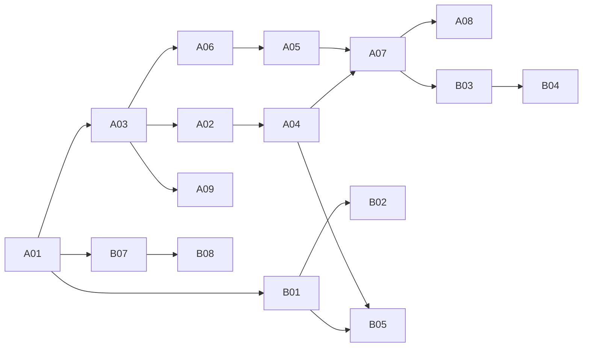

# DD-1.0 下一阶段工作计划与执行规程

最新执行（2026-11-08）：A09 本地静态交付准备已完成，工程 ready，发布与家长设备验收 pending，总状态 open；下一项可继续 **B01**。[本地验收](../verification/A09-static-samples-2026-11-08.md)记录 30 项定向检查和隔离 nginx 候选 4 / 回退 3 条路由通过；[交付与设备检查表](../open-webui-reuse/static-samples-delivery.md)已就绪。九文件固定提交与旧样本一致，当前 A07 桥接未混入。以下各批次更新保留历史语境。

最新执行：**A08本地维护机制已完成，下一项A09**。[验收](../verification/A08-tool-lifecycle-2026-11-07.md)记录54项与固定WebUI原生迁移schema、历史及缓存检查；[操作单](../open-webui-reuse/tool-upgrade-rollback.md)就绪，尚未正式应用。下方A07及更早为历史记录。

最新执行：**A07 本地接入已完成，下一项 A08**。[验收](../verification/A07-runtime-passages-2026-11-07.md)与[运行说明](../open-webui-reuse/textbook-passages-runtime.md)记录当前Tool 1.2.0及默认关闭策略；尚未提交、部署或实际体验验收。下方A05及之前的执行说明为历史记录。

版本：1.0。日期：2026-11-07。配套[实施方案](DD-1.0-NEXT-IMPLEMENTATION-2026-11-07.md)、[25 项台账](dd-next-work-tracker.json)与[续接指令](RESUME-NEXT-WORK.txt)。编制计划时未执行代码修改、发布、模型调用或 Goal 写入。执行进度见台账与下方更新。

## 1. 如何使用这份计划

实施方案定义“做什么、怎样做、怎样验收”；本文定义“先做哪项、投入多少、何时可以继续、如何交接”；JSON 台账记录最新进度。三者沿用[项目评审](../PROJECT-REVIEW-2026-11-07.md)中的任务编号，禁止另起相同含义的编号使历史证据失联。

开始一批时：读取台账与对应实施工作包 → 只读核对输入版本和未提交文件 → 选一个主任务及必要依赖 → 完成候选、定向验证、记录结果 → 更新台账与当前交付清单。某项等待家长反馈、人工资料或新的受限范围时，完成它能够独立完成的本地部分，再选择其他就绪任务。

**最新执行：A01、A03、A04、A06、A05 本地出口已完成；A02 已整理，待提交；A05 当时下一项 A07。** A05 [验证报告](../verification/A05-chapter-retrieval-2026-11-07.md)记录补充集召回 20/20、拒绝 10/10、泄漏 0/10，241 项单元/契约、4 项浏览器及原生六方法通过；Tool 候选 1.1.2，未提交/部署，五片段尚未接服务。 A06 [冻结评测与基线](../verification/A06-retrieval-evaluation-2026-11-07.md)保留 20 问开发、4 问回归，新增 40 问试点；73 项合成测试通过，基线召回 2/20、拒绝 2/10，检索质量未达标。 A04 [故障分类/恢复](../open-webui-reuse/study-error-recovery.md)与[验证报告](../verification/A04-study-errors-2026-11-07.md)记录 552 项单元/契约和原生六方法通过，未提交/部署。 A02 [交付单](../releases/A02-candidate-delivery-2026-11-07.md)覆盖 46 个文件，[本地验收](../verification/A02-candidate-delivery-2026-11-07.md)通过、总状态仍 open，提交等待不阻塞 A04。 A01 建立[当前状态](../releases/current-state.md)与[机器清单](../releases/current-manifest.json)，[验收记录](../verification/A01-current-state-2026-11-07.md)保留运行快照。A03 完成[可移植测试入口](../TESTING.md)，[干净环境验证](../verification/A03-portable-tests-2026-11-07.md)为 503 单元/契约 + 12 浏览器通过、零跳过；自动检查候选未提交，远端 CI 未运行。下面“首个批次”保留操作方法，不要求以后重复已通过且未改变的检查。

## 2. 优先级、依赖与投入

### 2.1 估算口径

按一名熟悉本仓库的工程执行者估算，单位为专注工作小时；每个工作日按 6 小时有效投入换算。包括局部实现、必要验证与交接，内容工作包含实际复核投入；不包括等待家长/教师/许可、下载或基础环境故障、真实提供商验收和大规模数据处理。不是报价或截止承诺。

P1 为 **58–101 小时，约 10–17 个有效工作日**；P2 为 **94–182 小时，约 16–31 个有效工作日**。合计 **152–283 小时，约 26–48 个有效工作日**，不是自然日上线日期。P3 启动条件未满足，不编造工期；启动时按冻结范围单独估算。每完成一个批次，根据实际耗时与发现的问题调整后续估算并保留原因。

表中依赖默认指上游的**必要本地产物与验证就绪**，不是要求上游所有发布/家长验收完成。例如 A02 的提交等待不阻止 A04 本地修复，A09 等家长反馈不阻止 B11 兼容测试。正式发布另看运行版本和有效授权。

### 2.2 25 项执行表

| ID | 优先级 | 任务 | 本地产物依赖 | 工时 | 建议批次 |
| --- | --- | --- | --- | --- | --- |
| A01 | P1 | 当前状态与兼容交付清单 | 无 | 3–5 | M1 |
| A03 | P1 | 可移植依赖、夹具与自动检查 | A01 | 8–14 | M1 |
| A02 | P1 | 整理已有候选及源码交付 | A01、A03 | 2–4 | M1 |
| A04 | P1 | 细分会话与 Tool 失败 | A02、A03 | 6–10 | M1 |
| A06 | P1 | 冻结独立评测与基线 | A01、A03 | 8–14 | M2 |
| A05 | P1 | 章内召回与资料不足判定 | A03、A06 | 8–16 | M2 |
| A07 | P1 | 服务与六方法 Tool 接入 5 片段 | A02、A04、A05、A06 | 12–20 | M2 |
| A08 | P1 | 既有 Tool 升级/回退机制 | A01、A07 | 8–12 | M2 |
| A09 | P1 | 静态三样本交付与反馈 | A01、A03 | 3–6 | MS，独立插入 |
| B01 | P2 | 一章覆盖图与已有题映射 | A01 | 4–8 | M3 |
| B02 | P2 | 备用练习与延迟检查 | B01、A03 | 12–24 | M3 |
| B05 | P2 | 显式错题收藏与到期复习 | A04、B01 | 10–18 | M3 |
| B03 | P2 | 片段复核工作台 | A07、B01 | 12–20 | M4 |
| B04 | P2 | 二下首批 5 页完整复核 | B03 | 10–24 | M4 |
| B07 | P2 | 基本备份与隔离恢复 | A01 | 8–16 | M5，可提前 |
| B08 | P2 | 最小运行观察 | A04、B07 | 4–8 | M5 |
| B06 | P2 | 跨设备轮次恢复 | A03、B05 | 8–16 | M6 |
| B09 | P2 | 首批模块拆分与类型契约 | A03、A07 | 12–20 | M6，随改动插入 |
| B10 | P2 | 测量性能、缓存与总截止 | A04、A07 | 8–16 | M6 |
| B11 | P2 | 上游兼容与家庭设备 | A03、A09 | 6–12 | M6，可随 MS 插入 |
| C01 | P3 | 真实模型引用与教学验收 | A06、A07、A08 | 启动后估算 | MG，受当前限制 |
| C02 | P3 | 真实卷面 OCR/诊断/变式验收 | A03、B03、C01 | 启动后估算 | MG，需资料与范围 |
| C03 | P3 | 完整恢复/删除增量/费用对账 | B07、B08 | 启动后估算 | MG，规模/付费触发 |
| C04 | P3 | 多学科小单元扩展 | B01、B02、B03、B04 | 启动后估算 | MG，课程需求触发 |
| C05 | P3 | RAGFlow 全栈/媒体再评估 | A05、A06、B10 | 启动后估算 | MG，实测瓶颈触发 |

以上 B04 估算仅覆盖首批 5 页及审核流程，不含后续扩到 10 页或整本书。B09 仅覆盖首批相关模块，不含全应用重构。A09 估算含候选与窄范围交付准备，不预设能在该工时内收到反馈。

### 2.3 核心依赖图



图只展示核心路径；完整依赖以表和台账为准。任务可交错推进，但不要同时修改同一组核心模块而无法区分验证对象；默认一条工程主线，内容复核或等待反馈可作为副线，不需要为此启用多 Agent。

## 3. 分批计划与阶段出口

| 批次 | 内容/预算 | 必须交付的结果 | 出口与接续 |
| --- | --- | --- | --- |
| M1 工程接续 | A01→A03→A02→A04；19–33h | 当前清单、可移植测试、候选分组、故障分类/恢复文案 | 工程出口通过即可进入 M2；提交动作按有效指令另记 |
| MS 静态样本 | A09；3–6h，A03 后可插入 | 样本候选、静态差异/回退、必要探针和设备清单 | 候选通过、已发布、家长通过分别记录；不占住 M2 |
| M2 引用试点 | A06→A05→A07→A08；36–62h | 冻结评测、章内检索方案、5 片段服务/Tool 候选、升级回退包 | 工程出口须达到试点指标和失效/隔离契约；发布后才可称在线片段可用 |
| M3 一章连续学习 | B01→B02；B01/A04→B05；26–50h | 可核对覆盖表、首批备用题、错题确认与复习入口 | 代码/内容通过后发布；实际 1/3/7 天观察按真实日期另记 |
| M4 内容审核节奏 | B03→B04；22–44h | 审核工作台及首批 5 页逐页处理清单 | 实际通过/待解分别统计；不以处理页数充当通过页数 |
| M5 家庭基本运维 | B07→B08；12–24h，可在 A01/A04 后提前 | 当前范围备份、隔离恢复报告、独立心跳与告警分类 | 归档校验、恢复、监控启用各有证据；缺独立副本继续待办 |
| M6 稳定性改进 | B06/B09/B10/B11；34–64h，按问题插入 | 持久轮次、首批纯业务模块、性能基线/截止、设备兼容记录 | 根据实际缺陷排序，不让重构挤掉内容和复习 |
| MG 条件式扩展 | C01–C05，暂不承诺排期 | 每项先有范围、输入、验收和投入决策 | 当前真实模型/外部 OCR 禁令不因计划存在而改变 |

执行窗口按有效投入推进。例如前 2–3 个有效工作日优先 A01 与 A03；完成后接 A02/A04。M1 约 4–6 个有效工作日，M2 约 6–11 个有效工作日，MS 约 0.5–1 日；三者并非必须连续占满自然周。单批结束必须重估，禁止为了追日程跳过引用或内容审核。

## 4. 首个批次的直接操作清单

### 4.1 A01：先核对，后写清单

下面是现有、只读且不含秘密的核对命令，必须在指定项目目录执行；Compose 路径不存在时先查交接，不改用旧路径。

```bash
cd /home/deniskorfei/projects/open-webui
git status --short --branch
git rev-parse HEAD
git diff --stat
docker compose --env-file /dev/null -p dd-family-math \
  -f learning_data/deployments/family-math-20261105/compose-main-study-20261106.json ps
docker inspect --format '{{.Name}} {{.Image}} {{.State.Status}} {{.State.StartedAt}}' open-webui
rg -n 'alias |proxy_pass http://open-webui:8080' \
  learning_data/deployments/family-math-20261105/main-study-20261106/nginx.conf
```

不用完整 `docker inspect` 或 Compose `config` 输出环境变量。Tool 正式源码未重新读取时，记录“沿用注册证据，未本次复核”，不为补清单而越权读取生产库。

随后创建 A01 当前清单，逐项对照本方案第 2 节，校正两处文档入口；保留历史文件时间语境。核对结束更新台账中的证据引用、耗时和下一动作，不改 Goal 文件。若发现新故障，先明确受影响能力；无已证实故障不自行停服。

### 4.2 A03：建立可复现检查入口

先列哪些测试依赖本机 PDF、浏览器可选导入和固定 Chrome 路径，再补依赖/夹具/配置；不要直接运行所有测试来碰运气。使用临时数据目录和原创合成教材，确认测试不触发默认生产环境或真实 provider。

按具体变更选择已有套件，如 `tests/test_textbooks.py`、`tests/test_readonly_study_tools.py`、`tests/test_textbook_passage_sample.py`、`tests/test_learning_release.py` 及相关浏览器文件。此处是选择范围，不要求每次全部运行。建立干净环境安装与分组命令后，把实际命令写入测试说明；当前未实现的升级/片段服务命令不得先写成可运行指令。

### 4.3 A02/A04：收敛可审阅候选

候选整理建议分为页级证据链、离线片段样本、工程测试基础/错误分类、计划与记录等可独立理解的单元；最终分组按真实文件依赖调整，不机械拆坏契约。保留既有材料路径与哈希。提交/推送只有在届时有效指令覆盖时执行，不把历史已完成的“推送”自动延伸为本轮所有新工作的授权。

A04 用合成错误覆盖根因分类；先写用户可执行的恢复方式，再校验日志是否泄漏身份/凭据。不要把修复目标扩大成重新绑定用户。

## 5. 台账字段与状态流转

[JSON 台账](dd-next-work-tracker.json)不是 Goal，也不调用 Goal API。所有 25 项初始化均未全项完成；已有候选只在工程字段记录。未来每批至少更新以下字段：

| 字段 | 含义与可取值 |
| --- | --- |
| `id / priority / milestone / title` | 稳定编号、P1/P2/P3、所属批次与名称 |
| `depends_on` | 前置任务 ID；默认满足的是必要本地产物，不是全部上线反馈 |
| `engineering_state` | `planned`、`existing_partial`、`in_progress`、`ready`、`deferred` |
| `delivery_state` | `not_applicable`、`not_scheduled`、`pending_commit`、`candidate_only`、`deployed` |
| `acceptance_state` | `not_started`、`pending`、`passed`、`gated`；家长/真实调用验收以详细记录为准 |
| `completion_state` | `open`、`deferred`、`complete`；只有本任务所有适用出口都满足才 complete |
| `estimate_hours / actual_hours` | 估算 min/max，未知填 null；实际未记录时 null，不假填 0 |
| `required_conditions` | 需要的实际材料/反馈/维护范围；不是一律要问权限 |
| `next_action` | 下一项可执行动作，不能只写“继续” |
| `evidence` | 本批实际证据；初始化为空，历史依据另放 `baseline_evidence` |
| `artifacts / blockers / last_updated` | 实际交付路径、具体阻塞与日期；预期产物在方案中，不伪装成已有文件 |

工程就绪后，适用的状态顺序通常为：`planned/existing_partial → in_progress → ready`；随后交付/反馈各自推进。`deferred` 表示按条件暂缓，不是工具 Goal 状态。受限事项未允许时保持该状态，不能靠等待时长当许可。

每次更新保留一条 `change_log`：时间、任务 ID、变更摘要、证据位置、下一步。如估算或范围调整，说明原因；不删除旧失败结果。人工角色的签署、实际设备反馈与模型质量结论只能由真实记录支持。

## 6. 每批执行 SOP

1. **恢复上下文。** 阅读本计划、台账和任务对应方案；按任务需要读取旧交接/验证，旧建议不当现状。检查未提交文件与依赖。
2. **固定输入。** 记录 SHA、文件哈希、内容版本、配置来源；新证据目录不能覆盖旧目录。检查当前日期与片段有效期。
3. **实现最小范围。** 先完成一个可评审工作包，保留旧兼容路径。普通实现选择由执行者判断，不为可逆局部修改反复询问。
4. **定向验证。** 用合成/隔离数据检查对应故障、越界、过期和回退；禁止真实模型/embedding/外部 OCR。既有测试不因换会话重复跑。
5. **记录结果。** 分别写实现、测试、发布、家长反馈、真实模型状态；失败写明确原因，不把跳过算通过。
6. **交付或继续。** 候选/回退包完备且授权范围适用则执行相应步骤；范围不适用则指出缺少条件，转做其他就绪任务。
7. **更新接续。** 同步台账、当前清单和脱敏验证记录，给出下一项。不会因写完记录自动提交/推送或创建 Goal。

建议每个工程批次以 3–6 小时的可验证增量收尾；长任务可跨会话，但保持一个固定候选和未解决项。B02 延迟观察、家长反馈和恢复介质准备不会强行塞入这个工作时段。

## 7. 验收记录与反馈模板

未来每批验证报告可采用以下结构，文件名使用任务 ID 和实际日期；详细敏感材料只存本地忽略目录。

```text
任务/子批次：
时间与执行角色：
输入基线：Git SHA / 脏文件哈希 / 组件版本 / 材料清单与有效期
本批范围及变更文件：
验证环境：合成/公开本地材料/隔离；是否挂正式数据；外部请求情况
实际命令与结果：collected / passed / failed / skipped + 失败解释
指标：分子/分母、集版本、阈值、未达标项
交付：候选位置 / 是否提交 / 是否发布 / 兼容及回退版本
实际反馈：设备、步骤、观察者、现象；没有反馈则待收集
未解决问题及下一步：
```

家长首轮只需按真实使用记录：从主站进伴学 → 选档案/书章 → 操作演示/路线 → 查看原页 → 开始关联练习 → 错题显式收藏 → 到期复习 → 换孩子开新聊天。每一步记“通过/失败/未试”和现象；当前自动执行不发送聊天模型请求，C01 另行处理。

## 8. 调整规则与暂停条件

出现身份/范围泄漏、证据篡改仍可引用、错误判分依据、旧资料撤回失效、破坏原始数据时，立即停止受影响候选或发布，保留现场与已有运行能力，按本次回退包处理。没有相关故障的其他任务继续推进。

性能没有基线先测量，接口不支持章节过滤先采用有界试点并说明未解决范围，内容缺人工核验先留待审，家长没反馈就保持待反馈。不得以加 k、增加同义词、增加测试数或部署新平台代替缺失证据。

新增用户反馈可以改变 P2 内顺序；安全隔离、内容真实性、A06 先冻结后优化的原则不因排期改变。正式模型禁令、生产访问范围和数据外发条件必须来自明确新指令，不能由这份计划自行解除。

## 9. 计划编制交付与最新接续

编制阶段交付的是实施方案、分批工作计划、25 项 JSON 台账和续接指令；`docs/README.md` 增加新入口。已存在的业务改动和私有材料保持原状。文档应检查 ID 完整性、依赖无环、估算合计、引用路径、状态口径和差异格式；不为文档变更重跑业务测试。

2026-11-07 文档校验结果：25 个唯一任务编号完整（P1/P2/P3 为 9/11/5），依赖无环，工作表与台账的依赖/批次/估算一致；20 处本地 Markdown 链接及台账历史依据路径有效；P1 58–101h、P2 94–182h、合计 152–283h。原有 14 个未提交/未跟踪文件逐文件 SHA256 比对未变；没有任务因本次编制计划被标记完成。本记录只证明计划一致性，不证明业务已实现。

下一次按“继续执行下一阶段计划，从 A02 开始”即可恢复。A01、A03 已完成，实际状态以台账为准；若已有更新，则选择依赖满足的最高优先级未完成任务，不能每次重做 A01，也不能把待真实验收误当所有工程任务的阻塞。
